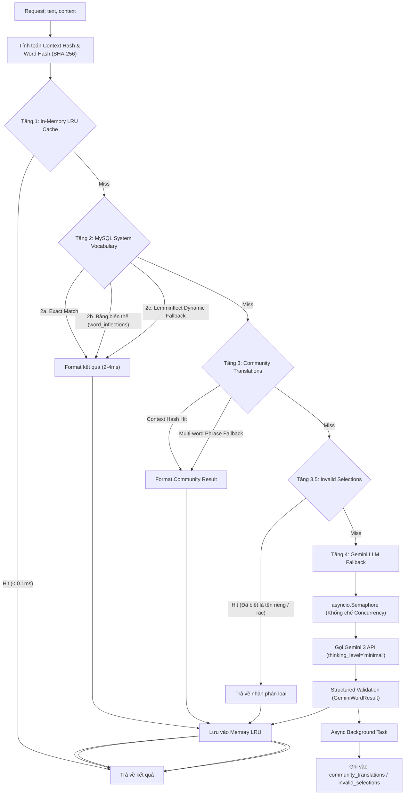

# Backend: Bôi đen dịch bằng AI & Tra cứu từ điển (Highlight-to-Translate)

> Tài liệu này mô tả chi tiết kiến trúc xử lý, quy trình phân giải từ vựng và các cơ chế tối ưu hóa hiệu năng phía Backend của tính năng **Bôi đen dịch bằng AI & Tra cứu từ điển ngữ cảnh** trên hệ thống `ilovetoeic.com`.
> **Phạm vi tài liệu:** Hoàn toàn tập trung vào kiến trúc Backend, luồng dữ liệu, thuật toán, cơ sở dữ liệu và API. Không đề cập đến thành phần giao diện người dùng (UI).

---

## 1. Mục tiêu và Nguyên lý thiết kế Backend

Tính năng tra cứu từ vựng khi bôi đen yêu cầu đáp ứng hai mục tiêu dường như mâu thuẫn:
1. **Độ trễ tiệm cận 0ms:** Học sinh đang làm bài thi hoặc đọc bài Reading cần nhận được nghĩa của từ ngay lập tức để không bị gián đoạn luồng tư duy.
2. **Ngữ cảnh chính xác cao:** Từ tiếng Anh trong bài thi TOEIC có nhiều nghĩa khác nhau tùy thuộc vào ngữ cảnh công sở, kinh doanh hoặc giao tiếp. Gọi LLM trực tiếp qua mạng tạo ra độ trễ lớn (1.5s - 7s) và tốn kém chi phí quota API.

Để giải quyết bài toán này, Backend thiết kế một **Kiến trúc phân giải 4 tầng (4-Tier Resolution Pipeline)** với chiến lược **Offload tối đa AI về cơ sở dữ liệu nội bộ**:

---

## 2. Các thành phần chính trong Backend

| Thành phần | Vị trí file | Trách nhiệm |
|---|---|---|
| **API Router** | [`server/app/routers/gemini.py`](file:///C:/android-server/toeic-website/server/app/routers/gemini.py) | Định nghĩa các endpoint RESTful: `/api/v1/translate`, `/batch`, `/details`, `/passage/{id}`, `/cache-stats`. |
| **Translation Engine** | [`server/app/services/gemini_service.py`](file:///C:/android-server/toeic-website/server/app/services/gemini_service.py) | Trọng tâm xử lý: quản lý cache LRU, tra cứu hệ thống từ vựng, phân giải biến thể từ (lemmatization), giao tiếp Gemini SDK, kiểm soát concurrency. |
| **Database Pool** | [`server/app/db.py`](file:///C:/android-server/toeic-website/server/app/db.py) | Cung cấp kết nối MySQL Connection Pool (`max_size=25`) cho các bảng từ điển và cache dịch thuật. |
| **System Cache Service** | [`server/app/services/cache_service.py`](file:///C:/android-server/toeic-website/server/app/services/cache_service.py) | Hỗ trợ Redis/In-memory cache tổng thể hệ thống. |

---

## 3. Mục lục tài liệu chuyên sâu

Các khía cạnh kỹ thuật chi tiết của tính năng được phân tách thành các tài liệu chuyên đề:

1. [**Kiến trúc & Pipeline phân giải 4 tầng (`architecture-and-pipeline.md`)**](./architecture-and-pipeline.md)
   - Chi tiết hoạt động của từng tầng tra cứu (Tier 1 đến Tier 4).
   - Logic phân loại từ ngữ (`word_type`: `vocabulary`, `proper_noun`, `invalid_selection`).
   - Quy trình ghi dữ liệu nền bất đồng bộ (Asynchronous Background Writeback).
   - Cơ chế dịch theo lô (Batch translation).

2. [**Các kỹ thuật tối ưu hóa hiệu năng & Caching (`optimizations-and-caching.md`)**](./optimizations-and-caching.md)
   - Kỹ thuật nạp trước từ vựng bài đọc (Passage Vocabulary Pre-warming) đạt độ trễ 0ms.
   - Cơ chế Lemmatization xử lý triệt để các dạng biến thể ngữ pháp (V-ed, V-ing, danh từ số nhiều, bất quy tắc).
   - Tải tiến trình theo tab (Progressive on-demand loading `/details`) tiết kiệm token.
   - Cấu hình Gemini 3: `thinking_level="minimal"` cắt giảm thời gian phản hồi từ 5s xuống < 1s.
   - Kiểm soát nghẽn mạng bằng `asyncio.Semaphore` chống tràn quota HTTP 429.
   - Context Hashing & Phrase Fallback Strategy.

3. [**Mô hình dữ liệu & Đặc tả API (`data-models-and-api.md`)**](./data-models-and-api.md)
   - Cấu trúc các bảng MySQL liên quan: `system_vocabulary_words`, `word_inflections`, `community_translations`, `invalid_selections`.
   - Đặc tả chi tiết các request/response endpoints và Pydantic schemas.
   - Thống kê giám sát hệ thống (Telemetry metrics `/cache-stats`).
