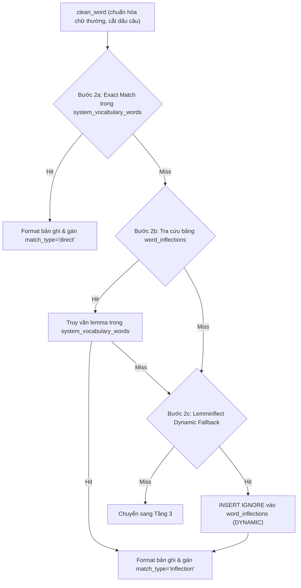

# Kiến trúc Xử lý & Pipeline Phân giải 4 tầng (Highlight-to-Translate Pipeline)

> Tài liệu này mô tả chi tiết luồng xử lý dữ liệu từ lúc Backend nhận request dịch thuật cho đến khi trả về kết quả, phân tích cơ chế phân tầng từ bộ nhớ RAM đến cơ sở dữ liệu MySQL và AI LLM.

---

## 1. Tổng quan Kiến trúc Phân tầng

Hệ thống xử lý tra cứu từ vựng và dịch thuật theo ngữ cảnh được thiết kế dựa trên nguyên lý **bảo vệ tài nguyên AI (AI Shielding)** và **tiệm cận độ trễ 0ms**:

```
[Request] -> [Tầng 1: RAM Cache (<0.1ms)]
                 | (miss)
             [Tầng 2: MySQL System Vocabulary (2-4ms)]
                 | (miss)
             [Tầng 3: Community Translations Cache (3-8ms)]
                 | (miss)
             [Tầng 3.5: Invalid Selections Memory (2-4ms)]
                 | (miss)
             [Tầng 4: Gemini LLM Fallback (800ms - 1.5s)]
                 |
             [Async Writeback vào DB & RAM Cache]
```

---

## 2. Chi tiết Hoạt động của Từng Tầng (Deep Dive Tiers)

### Tầng 1: In-Memory LRU RAM Cache (Độ trễ < 0.1ms)

- **Cấu trúc dữ liệu:** `collections.OrderedDict[str, Dict[str, Any]]` được khai báo trong [`gemini_service.py`](file:///C:/android-server/toeic-website/server/app/services/gemini_service.py) với tên `self.memory_cache`.
- **Dung lượng tối đa:** Được khống chế bởi `config.RAM_CACHE_MAX_SIZE` (mặc định 10,000 mục).
- **Thuật toán đào thải (Eviction Policy):** Least Recently Used (LRU).
  - Khi có Cache Hit: Gọi `self.memory_cache.move_to_end(text_hash)` để đưa mục được truy cập về cuối hàng đợi.
  - Khi Cache đầy (`len >= max_ram_cache_size`): Gọi `self.memory_cache.popitem(last=False)` để xóa mục ít sử dụng nhất ở đầu hàng đợi.
- **Cơ chế Hashing kép (Dual Hash Keys):**
  - **Context Hash:** SHA-256(`text:src_lang:target_lang:context`). Đảm bảo một từ khi xuất hiện ở hai ngữ cảnh khác nhau có thể được lưu trữ và dịch nghĩa chuẩn xác theo từng ngữ cảnh.
  - **Word-Only Hash:** SHA-256(`text:src_lang:target_lang:`). Sử dụng cho trường hợp ngữ cảnh tổng quát (`context` rỗng hoặc là `"toeic"`, `"general"`, `"default"`).
  - Khi tra cứu trong RAM, nếu `context_hash` bị trượt (miss) và ngữ cảnh đang ở chế độ tổng quát, hệ thống sẽ tra cứu tiếp `word_only_hash` trước khi chuyển sang Tầng 2.

---

### Tầng 2: MySQL System Vocabulary & Phân giải Biến thể (Độ trễ 2-4ms)

Tầng 2 khai thác bảng từ vựng hệ thống [`system_vocabulary_words`](file:///C:/android-server/toeic-website/server/migrations/20260907_01_add_system_vocabulary.sql) gồm hơn 20,000 từ vựng TOEIC/Oxford/IELTS chuẩn đã được biên soạn sẵn phiên âm quốc tế (IPA US/UK), định nghĩa, ví dụ song ngữ, collocations và họ từ.

Quy trình phân giải tại tầng 2 gồm 3 bước:



1. **Bước 2a (Exact Match):**
   - Làm sạch chuỗi (`strip(" \t\n\r\"'.,;:!?()[]{}<>`~*").lower()`).
   - Truy vấn SQL có ưu tiên:
     ```sql
     SELECT word, ipa, cefr, part_of_speech, meaning_vi, definition_en, 
            example_en, example_vi, example_toeic, audio_us, audio_uk, 
            synonyms, word_family, phrases
     FROM system_vocabulary_words 
     WHERE word = ? 
     ORDER BY (set_id IN ('1e3e6ebb-26a1-52f6-bdc5-1d743722fae2', '21793dec-3c53-4e8b-923a-72a2a3bf491a')) DESC, order_index ASC 
     LIMIT 1
     ```
   - Hai UUID trong điều kiện `ORDER BY` là các bộ từ vựng chuẩn TOEIC trọng tâm, đảm bảo nếu cùng một từ xuất hiện ở nhiều bộ từ thì bộ từ TOEIC cốt lõi luôn được ưu tiên hàng đầu.

2. **Bước 2b (Bảng Biến thể Ngữ pháp `word_inflections`):**
   - Học sinh khi đọc bài thi thường gặp các dạng chia thì, biến cách: *accommodated, accommodates, accommodating, accommodations*. Từ điển gốc chỉ lưu từ nguyên thể *accommodate*.
   - Bảng [`word_inflections`](file:///C:/android-server/toeic-website/server/migrations/20260909_02_add_word_inflections.sql) chứa 13,855 cặp ánh xạ đã được tiền tính toán (precomputed).
   - Truy vấn:
     ```sql
     SELECT lemma_word FROM word_inflections WHERE inflected_form = ? LIMIT 1
     ```
   - Lấy được `lemma_word`, hệ thống quay lại truy vấn `system_vocabulary_words` để lấy toàn bộ dữ liệu từ điển của từ gốc và bổ sung trường `lemma` vào kết quả trả về.

3. **Bước 2c (NLP Lemmatization Fallback & Tự động ghi nhớ):**
   - Nếu từ biến thể chưa có trong bảng `word_inflections`, hệ thống gọi thư viện `lemminflect.getAllLemmas(clean_word)`.
   - Lần lượt thử các ứng viên nguyên thể tìm được với `system_vocabulary_words`.
   - Nếu tìm thấy từ nguyên thể trong từ điển, hệ thống lập tức thực hiện truy vấn tự ghi nhớ vào MySQL:
     ```sql
     INSERT IGNORE INTO word_inflections (inflected_form, lemma_word, inflection_type) 
     VALUES (?, ?, 'DYNAMIC')
     ```
   - Cơ chế này biến hệ thống thành một **cơ chế tự hoàn thiện (self-expanding inflection graph)**: các từ biến thể mới chỉ cần giải mã NLP đúng 1 lần đầu tiên, từ lần truy vấn thứ 2 trở đi sẽ hit trực tiếp vào Bước 2b qua bảng MySQL chỉ mất 2ms.

---

### Tầng 3: Community Translations & Multi-word Phrase Fallback (Độ trễ 3-8ms)

Khi từ vựng hoặc cụm từ không nằm trong bộ từ vựng tĩnh của hệ thống, Backend chuyển sang tầng cache cộng đồng [`community_translations`](file:///C:/android-server/toeic-website/server/migrations/20260903_03_add_community_translations.sql).

- **Mục đích:** Lưu lại các bản dịch chất lượng cao từng được Gemini xử lý từ các bài thi trước đó của cộng đồng học viên.
- **Cơ chế phân giải:**
  1. **Strict Context Match:**
     ```sql
     SELECT * FROM community_translations WHERE word = ? AND context_hash = ? LIMIT 1
     ```
  2. **Multi-word Phrase Fallback:**
     - Đối với các cụm từ ghép, collocation hoặc thành ngữ cố định gồm $\ge 2$ từ (ví dụ: *"in accordance with"*, *"take into account"*, *"on behalf of"*), ngữ nghĩa tiếng Việt hầu như bất biến qua các ngữ cảnh bài đọc khác nhau.
     - Nếu không hit theo `context_hash`, hệ thống cho phép fallback tra cứu theo chuỗi từ ghép:
       ```sql
       SELECT * FROM community_translations WHERE word = ? ORDER BY hit_count DESC LIMIT 1
       ```
     - Bản ghi có `hit_count` cao nhất (được nhiều người tra cứu nhất) sẽ được chọn.
  3. **Tự động tăng tần suất:** Khi hit bản ghi, hệ thống thực hiện `UPDATE community_translations SET hit_count = hit_count + 1 WHERE id = ?`.
  4. **Tương thích ngược (Backward Compatibility):** Nếu không tìm thấy trong `community_translations`, hệ thống kiểm tra bảng cũ `translation_cache` theo `hash`.

---

### Tầng 3.5: Invalid Selections & Proper Nouns Memory (Độ trễ 2-4ms)

Trong quá trình làm bài thi, người dùng thường bôi đen nhầm các chuỗi không phải từ vựng tiếng Anh thông dụng:
- Tên riêng người hoặc tổ chức: *"Wilson"*, *"Partyon"*, *"Westchester"*.
- Chuỗi bị dính chữ do lỗi format văn bản: *"westchesterreviews"*, *"formbelow"*.
- Đoạn âm tiết bị cắt cụt: *"accom"*, *"tion"*.
- Nhãn câu hỏi trắc nghiệm: *"A"*, *"B"*, *"C"*, *"D"*.

Nếu không có Tầng 3.5, mỗi khi học sinh bôi đen các chuỗi này, hệ thống sẽ liên tục gọi API Gemini làm lãng phí quota và tăng độ trễ.
- **Bảng lưu trữ:** [`invalid_selections`](file:///C:/android-server/toeic-website/server/migrations/20260909_04_add_invalid_selections.sql).
- **Hoạt động:**
  - Tra cứu: `SELECT * FROM invalid_selections WHERE word = ? LIMIT 1`.
  - Nếu tồn tại, trả về ngay cấu trúc phản hồi với `word_type` tương ứng (`"proper_noun"` hoặc `"invalid_selection"`), `part_of_speech="proper noun"`, không sinh ví dụ hay từ đồng nghĩa.
  - Cập nhật tăng `hit_count`.

---

### Tầng 4: Gemini LLM Fallback (Độ trễ 800ms - 1.5s)

Chỉ khi cả 4 tầng trên đều Miss, request mới được chuyển đến LLM Google Gemini.

#### 1. Kiểm soát Concurrency bằng `asyncio.Semaphore`
```python
self.semaphore = asyncio.Semaphore(config.MAX_GEMINI_CONCURRENCY)
```
- Ngăn chặn tình trạng đồng thời bắn hàng chục request tới Google API làm cạn kiệt Rate Limit hoặc dính lỗi HTTP 429 (`RESOURCE_EXHAUSTED`).
- Các request vượt ngưỡng sẽ xếp hàng chờ thay vì bị từ chối ngay.

#### 2. Tối ưu hóa Tham số Gọi Model
- **Model:** `config.GEMINI_MODEL` (mặc định `gemini-2.5-flash` / `gemini-3.5-flash-lite`).
- **Temperature:** `0.15` (giữ độ chính xác từ điển, chống ảo giác).
- **Thinking Level:** `thinking_config=types.ThinkingConfig(thinking_level="minimal")` - tắt bỏ phần suy nghĩ nội bộ kéo dài 4-6 giây của kiến trúc reasoning mới, đưa thời gian phản hồi về dưới 1 giây.
- **Structured Output:** Ép cấu trúc chặt chẽ thông qua Pydantic `response_schema=GeminiWordResult`.

#### 3. Prompt Kỹ nghệ Phân loại Ngữ cảnh
Prompt yêu cầu model phân loại rõ ràng 3 nhóm:
1. `vocabulary`: Từ vựng phổ thông phù hợp để học.
2. `proper_noun`: Tên người, thương hiệu, địa danh.
3. `invalid_selection`: Chuỗi gõ sai, dính chữ, nhãn trắc nghiệm.

---

## 3. Quy trình Ghi nền Bất đồng bộ (Asynchronous Background Writeback)

Khi Gemini trả về kết quả, Backend không bắt Client phải chờ việc ghi cơ sở dữ liệu hoàn tất mà thực hiện tách luồng:

1. Format dữ liệu và lưu ngay vào `self.memory_cache` (Tầng 1).
2. Tạo tác vụ nền bằng `asyncio.create_task()`:
   ```python
   word_type = result.get("word_type", "vocabulary")
   if word_type == "vocabulary":
       # Lưu vào community_translations
       asyncio.create_task(asyncio.to_thread(self._save_community_translation, clean_text, context_hash, result, context))
       if (is_phrase or is_generic_context) and context_hash != word_only_hash:
           self._save_to_memory_cache(word_only_hash, result)
           asyncio.create_task(asyncio.to_thread(self._save_community_translation, clean_text, word_only_hash, result, ""))
   else:
       # Ghi nhận vào invalid_selections để cách ly khỏi từ điển chính
       asyncio.create_task(asyncio.to_thread(self._save_invalid_selection, clean_text, word_type, result.get("translated_text", "")))
   ```
3. Trả ngay HTTP Response 200 về Client.

---

## 4. Pipeline Dịch theo Lô (Batch Translation Flow)

Khi một màn hình bài giảng hoặc danh sách từ vựng cần dịch nhiều mục cùng lúc, hệ thống cung cấp endpoint `POST /api/v1/translate/batch`:
- **Giới hạn an toàn:** Tối đa 50 phần tử/request.
- **Thực thi:**
  ```python
  tasks = [
      gemini_service.translate_text(
          text=item.strip(),
          src_lang=req.source_lang,
          target_lang=req.target_lang,
          context=req.context
      )
      for item in req.items if item and item.strip()
  ]
  results = await asyncio.gather(*tasks)
  ```
- **Lợi ích:** Toàn bộ các từ đã có trong Tầng 1 hoặc Tầng 2 sẽ phân giải tức thì trong vài microsecond. Các từ còn lại được điều tiết qua `Semaphore` mà không gây sập worker process.
