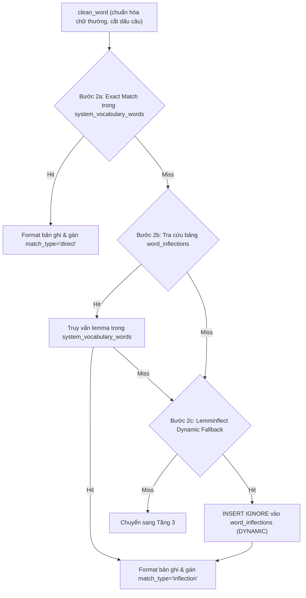

# Kiến trúc Xử lý & Pipeline Phân giải 4 tầng (Highlight-to-Translate Pipeline)

> Tài liệu này mô tả chi tiết luồng xử lý dữ liệu từ lúc Backend nhận request dịch thuật cho đến khi trả về kết quả, phân tích cơ chế phân tầng từ bộ nhớ RAM đến cơ sở dữ liệu MySQL và AI LLM.

---

## 1. Tổng quan Kiến trúc Phân tầng

Hệ thống xử lý tra cứu từ vựng và dịch thuật theo ngữ cảnh được thiết kế dựa trên nguyên lý **bảo vệ tài nguyên AI (AI Shielding)**, **khả năng scale hàng nghìn người dùng đồng thời**, và **tiệm cận độ trễ 0ms**:

```
[Request từ Frontend / Batch]
           │
           ▼
[Tầng 0: Local In-Memory LRU Cache (< 0.01ms)]
           │ (miss)
           ▼
[Tầng 1: Redis Distributed Shared Cache (< 1-2ms)]
           │ (miss)
           ▼
[Tầng 2: MySQL System Vocabulary & Inflections via asyncmy (1-3ms)]
           │ (miss)
           ▼
[Tầng 3: Community Translations Cache via asyncmy (2-4ms)]
           │ (miss)
           ▼
[Tầng 3.5: Invalid Selections Memory via asyncmy (1-3ms)]
           │ (miss)
           ▼
[Tầng 4: AI Protection Gateway]
    ├── 1. Circuit Breaker (Fast-Fail < 5ms khi AI gián đoạn)
    ├── 2. Sliding-Window Rate Limiter (Max 30 req/min/IP)
    └── 3. Single-Flight Request Coalescing (In-Process + Redis Distributed Lock)
           │ (Chỉ 1 request duy nhất được gọi ra ngoài)
           ▼
[Google Gemini 2.5/3.5 Flash Lite API (800ms - 1.2s)]
           │
           ▼
[Write-Behind Buffer (Redis HINCRBY / SADD) ──► Định kỳ 60s Batch Flush vào MySQL]
```

---

## 2. Chi tiết Hoạt động của Từng Tầng (Deep Dive Tiers)

### Tầng 0: Local In-Memory LRU RAM Cache (Độ trễ < 0.01ms)

- **Cấu trúc dữ liệu:** `collections.OrderedDict[str, Dict[str, Any]]` trong [`gemini_service.py`](file:///C:/android-server/toeic-website/server/app/services/gemini_service.py) (`self.memory_cache`).
- **Dung lượng tối đa:** Khống chế bởi `config.L0_CACHE_MAX_SIZE` (mặc định 1,000 mục trên mỗi worker process).
- **Thuật toán đào thải:** Least Recently Used (LRU) thuần túy in-process. Phục hồi ngay lập tức không tốn I/O hay socket call.
- **Cơ chế Hashing kép (Dual Hash Keys):**
  - **Context Hash:** SHA-256(`text:src_lang:target_lang:context`). Đảm bảo một từ khi xuất hiện ở hai ngữ cảnh khác nhau có thể được lưu trữ và dịch nghĩa chuẩn xác theo từng ngữ cảnh.
  - **Word-Only Hash:** SHA-256(`text:src_lang:target_lang:`). Dành cho ngữ cảnh tổng quát (`context` rỗng hoặc là `"toeic"`, `"general"`, `"default"`).

---

### Tầng 1: Redis Distributed Shared Cache (Độ trễ < 1-2ms)

- **Công nghệ:** `redis.asyncio` không khóa event loop.
- **Mục đích:** Chia sẻ toàn bộ bản dịch và từ điển qua tất cả các Gunicorn worker processes và các container/VPS khác nhau.
- **Khóa Redis:** `translate:word:{hash}` (hỗ trợ cả context_hash và word_only_hash).
- **TTL tối ưu:**
  - Từ vựng hợp lệ (`vocabulary`): **30 ngày** (`30 * 86400`).
  - Chuỗi rác / nhãn trắc nghiệm (`invalid_selection`): **7 ngày** (`7 * 86400`).
  - Từ vựng nạp trước bài đọc (`translate:passage:{passage_id}`): **24 giờ** (`86400`).
- **Tự động phục hồi:** Khi L0 Miss nhưng L1 Hit, kết quả lập tức được nạp ngược lại vào L0 của worker hiện tại để các lần tra cứu tiếp theo đạt độ trễ 0ms.

---

### Tầng 2: MySQL System Vocabulary & Phân giải Biến thể qua `asyncmy` (Độ trễ 1-3ms)

Tầng 2 khai thác bảng từ vựng hệ thống [`system_vocabulary_words`](file:///C:/android-server/toeic-website/server/migrations/20260907_01_add_system_vocabulary.sql) gồm hơn 20,000 từ vựng TOEIC/Oxford/IELTS chuẩn đã được biên soạn sẵn phiên âm quốc tế (IPA US/UK), định nghĩa, ví dụ song ngữ, collocations và họ từ.

Quy trình phân giải tại tầng 2 gồm 3 bước:



1. **Bước 2a (Exact Match):**
   - Làm sạch chuỗi (`strip(" \t\n\r\"'.,;:!?()[]{}<>`~*").lower()`).
   - Truy vấn SQL có ưu tiên:
     ```sql
     SELECT word, ipa, cefr, part_of_speech, meaning_vi, definition_en, 
            example_en, example_vi, example_toeic, audio_us, audio_uk, 
            synonyms, word_family, phrases
     FROM system_vocabulary_words 
     WHERE word = ? 
     ORDER BY (set_id IN ('1e3e6ebb-26a1-52f6-bdc5-1d743722fae2', '21793dec-3c53-4e8b-923a-72a2a3bf491a')) DESC, order_index ASC 
     LIMIT 1
     ```
   - Hai UUID trong điều kiện `ORDER BY` là các bộ từ vựng chuẩn TOEIC trọng tâm, đảm bảo nếu cùng một từ xuất hiện ở nhiều bộ từ thì bộ từ TOEIC cốt lõi luôn được ưu tiên hàng đầu.

2. **Bước 2b (Bảng Biến thể Ngữ pháp `word_inflections`):**
   - Học sinh khi đọc bài thi thường gặp các dạng chia thì, biến cách: *accommodated, accommodates, accommodating, accommodations*. Từ điển gốc chỉ lưu từ nguyên thể *accommodate*.
   - Bảng [`word_inflections`](file:///C:/android-server/toeic-website/server/migrations/20260909_02_add_word_inflections.sql) chứa 13,855 cặp ánh xạ đã được tiền tính toán (precomputed).
   - Truy vấn:
     ```sql
     SELECT lemma_word FROM word_inflections WHERE inflected_form = ? LIMIT 1
     ```
   - Lấy được `lemma_word`, hệ thống quay lại truy vấn `system_vocabulary_words` để lấy toàn bộ dữ liệu từ điển của từ gốc và bổ sung trường `lemma` vào kết quả trả về.

3. **Bước 2c (NLP Lemmatization Fallback & Tự động ghi nhớ):**
   - Nếu từ biến thể chưa có trong bảng `word_inflections`, hệ thống gọi thư viện `lemminflect.getAllLemmas(clean_word)`.
   - Lần lượt thử các ứng viên nguyên thể tìm được với `system_vocabulary_words`.
   - Nếu tìm thấy từ nguyên thể trong từ điển, hệ thống lập tức thực hiện truy vấn tự ghi nhớ vào MySQL:
     ```sql
     INSERT IGNORE INTO word_inflections (inflected_form, lemma_word, inflection_type) 
     VALUES (?, ?, 'DYNAMIC')
     ```
   - Cơ chế này biến hệ thống thành một **cơ chế tự hoàn thiện (self-expanding inflection graph)**: các từ biến thể mới chỉ cần giải mã NLP đúng 1 lần đầu tiên, từ lần truy vấn thứ 2 trở đi sẽ hit trực tiếp vào Bước 2b qua bảng MySQL chỉ mất 2ms.

---

### Tầng 3: Community Translations & Multi-word Phrase Fallback (Độ trễ 3-8ms)

Khi từ vựng hoặc cụm từ không nằm trong bộ từ vựng tĩnh của hệ thống, Backend chuyển sang tầng cache cộng đồng [`community_translations`](file:///C:/android-server/toeic-website/server/migrations/20260903_03_add_community_translations.sql).

- **Mục đích:** Lưu lại các bản dịch chất lượng cao từng được Gemini xử lý từ các bài thi trước đó của cộng đồng học viên.
- **Cơ chế phân giải:**
  1. **Strict Context Match:**
     ```sql
     SELECT * FROM community_translations WHERE word = ? AND context_hash = ? LIMIT 1
     ```
  2. **Multi-word Phrase Fallback:**
     - Đối với các cụm từ ghép, collocation hoặc thành ngữ cố định gồm $\ge 2$ từ (ví dụ: *"in accordance with"*, *"take into account"*, *"on behalf of"*), ngữ nghĩa tiếng Việt hầu như bất biến qua các ngữ cảnh bài đọc khác nhau.
     - Nếu không hit theo `context_hash`, hệ thống cho phép fallback tra cứu theo chuỗi từ ghép:
       ```sql
       SELECT * FROM community_translations WHERE word = ? ORDER BY hit_count DESC LIMIT 1
       ```
     - Bản ghi có `hit_count` cao nhất (được nhiều người tra cứu nhất) sẽ được chọn.
   3. **Đệm tần suất ghi nền (Write-Behind Buffering):** Khi hit bản ghi, hệ thống không gọi `UPDATE` trực tiếp vào MySQL mà gọi `await self._increment_hit_count("community", rec["id"])` để đẩy vào Redis hash `hit_counts:community` trong < 0.2ms.
   4. **Tương thích ngược (Backward Compatibility):** Nếu không tìm thấy trong `community_translations`, hệ thống kiểm tra bảng cũ `translation_cache` theo `hash`.

---

### Tầng 3.5: Invalid Selections & Proper Nouns Memory (Độ trễ 1-3ms)

Trong quá trình làm bài thi, người dùng thường bôi đen nhầm các chuỗi không phải từ vựng tiếng Anh thông dụng:
- Tên riêng người hoặc tổ chức: *"Wilson"*, *"Partyon"*, *"Westchester"*.
- Chuỗi bị dính chữ do lỗi format văn bản: *"westchesterreviews"*, *"formbelow"*.
- Đoạn âm tiết bị cắt cụt: *"accom"*, *"tion"*.
- Nhãn câu hỏi trắc nghiệm: *"A"*, *"B"*, *"C"*, *"D"*.

Nếu không có Tầng 3.5, mỗi khi học sinh bôi đen các chuỗi này, hệ thống sẽ liên tục gọi API Gemini làm lãng phí quota và tăng độ trễ.
- **Bảng lưu trữ:** [`invalid_selections`](file:///C:/android-server/toeic-website/server/migrations/20260909_04_add_invalid_selections.sql).
- **Hoạt động:**
  - Tra cứu: `SELECT * FROM invalid_selections WHERE word = ? LIMIT 1` (qua `asyncmy`).
  - Nếu tồn tại, trả về ngay cấu trúc phản hồi với `word_type` tương ứng (`"proper_noun"` hoặc `"invalid_selection"`), `part_of_speech="proper noun"`, không sinh ví dụ hay từ đồng nghĩa.
  - Cập nhật tăng `hit_count` qua Redis hash buffer: `await self._increment_hit_count("invalid", invalid_record["id"])`.

---

### Tầng 4: AI Protection Gateway & Gemini LLM Fallback (Độ trễ 800ms - 1.2s)

Chỉ khi cả 4 tầng trên đều Miss, request mới được chuyển đến Tầng 4. Tầng này được bao bọc bởi 3 lớp bảo vệ chặt chẽ:

#### 1. Bộ ngắt mạch Circuit Breaker & Fallback Suy giảm Nhẹ (< 5ms)
- **Kiểm tra trạng thái:** Trước khi kích hoạt bất kỳ tác vụ nào, hệ thống kiểm tra `can_attempt()`:
  - Nếu mạch đang `OPEN` (do trước đó gặp 5 lỗi liên tiếp từ AI): Hệ thống **không gọi Gemini** mà chuyển thẳng sang `_degraded_fallback(clean_text)` trả về kết quả gần đúng từ vựng hoặc dạng biến thể trong < 5ms.
  - Trạng thái `HALF_OPEN`: Cho phép 1 canary request thử nghiệm sau 30s cooldown để tự động phục hồi về `CLOSED`.

#### 2. Gom cụm yêu cầu đồng thời (Single-Flight Request Coalescing)
- Sử dụng `execute_single_flight(context_hash, _execute_gemini_call)`:
  - **Trong worker:** 50 requests đồng thời cho cùng 1 từ chỉ sinh ra đúng 1 cuộc gọi Leader; 49 requests Followers cùng await kết quả từ Leader Future.
  - **Xuyên worker:** Redis distributed lock `locks:gemini:{key}` đảm bảo giữa nhiều worker tiến trình cũng chỉ có duy nhất 1 worker gọi API.

#### 3. Giới hạn tần suất trượt (Sliding-Window Rate Limiting)
- Được kiểm tra ngay bên trong Leader execution: tối đa 30 lượt tra từ mới/phút/IP.
- Vượt ngưỡng sẽ trả về HTTP 429 kèm `Retry-After`. Toàn bộ các request hit cache Tầng 1, 2, 3 hoàn toàn không bị ảnh hưởng.

#### 4. Khống chế Concurrency & Tối ưu hóa Model
- `asyncio.Semaphore(config.MAX_GEMINI_CONCURRENCY)` (mặc định 5).
- Model: `config.GEMINI_MODEL` (`gemini-2.5-flash` / `gemini-3.5-flash-lite`).
- Temperature: `0.15`.
- Thinking: `thinking_config=types.ThinkingConfig(thinking_level="minimal")` (triệt tiêu internal reasoning latency).
- Structured Output: `response_schema=GeminiWordResult`.

---

## 3. Quy trình Ghi nền Đệm Hàng loạt (Write-Behind Buffering & Atomic Flush)

Khi Gemini trả về kết quả, Backend không ghi tuần tự vào MySQL để tránh giữ lock:

1. **Lưu cache tức thì:** Đưa vào L0 Local LRU và L1 Redis Shared Cache (`set` với TTL 30 ngày).
2. **Ghi nhận từ điển cộng đồng:**
   - Nếu `word_type == "vocabulary"`: Lưu bản dịch vào `community_translations`.
   - Nếu là từ rác: Lưu vào `invalid_selections`.
3. **Bộ đệm Write-Behind (Write-Behind Buffer):**
   - Bộ đếm lượt xem (`hit_count`) và biến thể mới (`word_inflections`) được lưu tạm trên Redis.
   - Định kỳ mỗi 60 giây, một background task chạy ngầm tổng hợp toàn bộ các thay đổi và thực thi câu lệnh SQL hàng loạt (`async_executemany`) với `invalidate_cache=False`.
   - Khi server shutdown, sự kiện lifespan sẽ flush toàn bộ dữ liệu tồn đọng trong Redis vào MySQL, triệt tiêu 100% rủi ro mất dữ liệu.


---

## 4. Pipeline Dịch theo Lô (Batch Translation Flow)

Khi một màn hình bài giảng hoặc danh sách từ vựng cần dịch nhiều mục cùng lúc, hệ thống cung cấp endpoint `POST /api/v1/translate/batch`:
- **Giới hạn an toàn:** Tối đa 50 phần tử/request.
- **Thực thi:**
  ```python
  tasks = [
      gemini_service.translate_text(
          text=item.strip(),
          src_lang=req.source_lang,
          target_lang=req.target_lang,
          context=req.context
      )
      for item in req.items if item and item.strip()
  ]
  results = await asyncio.gather(*tasks)
  ```
- **Lợi ích:** Toàn bộ các từ đã có trong Tầng 1 hoặc Tầng 2 sẽ phân giải tức thì trong vài microsecond. Các từ còn lại được điều tiết qua `Semaphore` mà không gây sập worker process.
