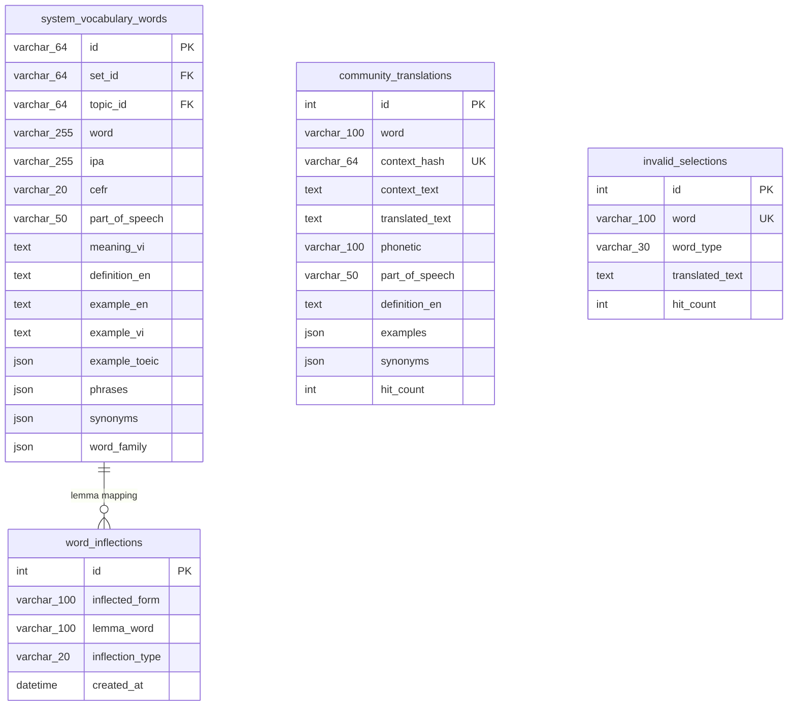

# Mô hình Dữ liệu & Đặc tả RESTful API Backend

> Tài liệu này cung cấp đặc tả kỹ thuật chi tiết về cấu trúc cơ sở dữ liệu MySQL, các Pydantic Data Transfer Objects (DTO) và chuẩn giao tiếp RESTful API của tính năng Bôi đen dịch AI & Tra cứu từ điển.

---

## 1. Cấu trúc Cơ sở Dữ liệu MySQL (Database Schemas)

Hệ thống sử dụng 5 bảng trong cơ sở dữ liệu `toeic_db` để phục vụ toàn bộ quy trình tra cứu từ vựng:



---

### Bảng 1: `system_vocabulary_words` (Từ vựng Hệ thống Chuẩn)
Lưu trữ kho từ vựng biên soạn tĩnh chất lượng cao (>20,000 từ).

```sql
CREATE TABLE IF NOT EXISTS system_vocabulary_words (
    id VARCHAR(64) PRIMARY KEY,
    set_id VARCHAR(64) NOT NULL,
    topic_id VARCHAR(64) NOT NULL,
    part_id VARCHAR(64) NOT NULL,
    word VARCHAR(255) NOT NULL,
    ipa VARCHAR(255) NULL,
    cefr VARCHAR(20) NULL,
    part_of_speech VARCHAR(50) NULL,
    meaning_vi TEXT NOT NULL,
    definition_en TEXT NULL,
    example_en TEXT NULL,
    example_vi TEXT NULL,
    example_toeic JSON NULL,
    audio_us VARCHAR(500) NULL,
    audio_uk VARCHAR(500) NULL,
    image_url VARCHAR(500) NULL,
    synonyms JSON NULL,
    antonyms JSON NULL,
    phrases JSON NULL,
    confusables JSON NULL,
    word_family JSON NULL,
    audio_voices JSON NULL,
    note_vi TEXT NULL,
    toeic_topic VARCHAR(100) NULL,
    difficulty_level INT NOT NULL DEFAULT 1,
    order_index INT NOT NULL DEFAULT 0,
    INDEX idx_sys_vocab_words_topic (topic_id, order_index),
    INDEX idx_sys_vocab_words_set (set_id),
    INDEX idx_sys_vocab_words_word (word)
) ENGINE=InnoDB DEFAULT CHARSET=utf8mb4 COLLATE=utf8mb4_unicode_ci;
```

---

### Bảng 2: `word_inflections` (Ánh xạ Biến thể Hình thái học)
Lưu các liên kết giữa dạng từ biến thể (chia thì, số nhiều...) và từ nguyên thể (lemma).

```sql
CREATE TABLE IF NOT EXISTS word_inflections (
    id INT AUTO_INCREMENT PRIMARY KEY,
    inflected_form VARCHAR(100) NOT NULL,
    lemma_word VARCHAR(100) NOT NULL,
    inflection_type VARCHAR(20) NOT NULL DEFAULT 'REGULAR',
    created_at DATETIME NOT NULL DEFAULT CURRENT_TIMESTAMP,
    UNIQUE KEY uk_inflected_lemma (inflected_form, lemma_word),
    INDEX idx_inflected_form (inflected_form),
    INDEX idx_lemma_word (lemma_word)
) ENGINE=InnoDB DEFAULT CHARSET=utf8mb4 COLLATE=utf8mb4_unicode_ci;
```
- **Các giá trị của `inflection_type`:**
  - `VBD`: Quá khứ đơn (Past tense verb - ví dụ: *abandoned*).
  - `VBG`: Phân từ hiện tại / Danh động từ (Gerund/Present participle - ví dụ: *abandoning*).
  - `VBZ`: Động từ ngôi thứ ba số ít (3rd person singular - ví dụ: *abandons*).
  - `NNS`: Danh từ số nhiều (Noun plural - ví dụ: *abatements*).
  - `JJR`: Tính từ so sánh hơn (Comparative adjective - ví dụ: *abler*).
  - `JJS`: Tính từ so sánh nhất (Superlative adjective - ví dụ: *ablest*).
  - `DYNAMIC`: Biến thể mới được NLP phát hiện tự động trong runtime.

---

### Bảng 3: `community_translations` (Cache Bản dịch Ngữ cảnh Cộng đồng)
Lưu trữ các từ/cụm từ nằm ngoài từ điển hệ thống đã được Gemini biên dịch thành công.

```sql
CREATE TABLE IF NOT EXISTS community_translations (
    id INT AUTO_INCREMENT PRIMARY KEY,
    word VARCHAR(100) NOT NULL,
    context_hash VARCHAR(64) NOT NULL,
    context_text TEXT NULL,
    translated_text TEXT NOT NULL,
    phonetic VARCHAR(100) NULL,
    phonetic_us VARCHAR(100) NULL,
    phonetic_uk VARCHAR(100) NULL,
    audio_us VARCHAR(500) NULL,
    audio_uk VARCHAR(500) NULL,
    part_of_speech VARCHAR(50) NULL,
    definition_en TEXT NULL,
    examples JSON NULL,
    synonyms JSON NULL,
    hit_count INT NOT NULL DEFAULT 1,
    source_lang VARCHAR(10) NOT NULL DEFAULT 'en',
    target_lang VARCHAR(10) NOT NULL DEFAULT 'vi',
    created_at DATETIME NOT NULL DEFAULT CURRENT_TIMESTAMP,
    updated_at DATETIME NOT NULL DEFAULT CURRENT_TIMESTAMP ON UPDATE CURRENT_TIMESTAMP,
    UNIQUE KEY uq_word_context_hash (word, context_hash),
    INDEX idx_context_hash (context_hash),
    INDEX idx_word (word)
) ENGINE=InnoDB DEFAULT CHARSET=utf8mb4 COLLATE=utf8mb4_unicode_ci;
```

---

### Bảng 4: `invalid_selections` (Bộ nhớ Chuỗi Rác & Tên riêng)
Cách ly tên riêng, ký tự gõ nhầm hoặc nhãn đáp án để không làm ô nhiễm kho từ vựng chính.

```sql
CREATE TABLE IF NOT EXISTS invalid_selections (
    id INT AUTO_INCREMENT PRIMARY KEY,
    word VARCHAR(100) NOT NULL,
    word_type VARCHAR(30) NOT NULL DEFAULT 'invalid_selection',
    translated_text TEXT NULL,
    hit_count INT NOT NULL DEFAULT 1,
    created_at DATETIME NOT NULL DEFAULT CURRENT_TIMESTAMP,
    updated_at DATETIME NOT NULL DEFAULT CURRENT_TIMESTAMP ON UPDATE CURRENT_TIMESTAMP,
    UNIQUE KEY uq_invalid_word (word),
    INDEX idx_word_type (word_type)
) ENGINE=InnoDB DEFAULT CHARSET=utf8mb4 COLLATE=utf8mb4_unicode_ci;
```
- **Các giá trị của `word_type`:**
  - `proper_noun`: Tên người, tên công ty, địa danh riêng biệt (*Wilson, Drew, Partyon*).
  - `invalid_selection`: Từ nối dính chữ (*westchesterreviews*), nhãn đề thi (*A, B, C, D*), âm tiết khuyết (*tion, ing*).

---

## 2. Đặc tả RESTful API Endpoints

Tất cả endpoint đều thuộc prefix `/api/v1/translate` được định nghĩa trong [`server/app/routers/gemini.py`](file:///C:/android-server/toeic-website/server/app/routers/gemini.py).

---

### 1. Dịch Từ vựng / Cụm từ Đơn lẻ
- **Endpoint:** `POST /api/v1/translate`
- **Mô tả:** Tra cứu nghĩa của từ hoặc cụm từ được bôi đen theo ngữ cảnh cụ thể. Áp dụng toàn bộ quy trình phân giải 4 tầng.

#### Request Body
```json
{
  "text": "accommodated",
  "source_lang": "en",
  "target_lang": "vi",
  "context": "The hotel accommodated all conference guests."
}
```

#### Response (HTTP 200 OK)
```json
{
  "source_text": "accommodated",
  "lemma": "accommodate",
  "word_type": "vocabulary",
  "translated_text": "cung cấp chỗ ở, đáp ứng",
  "phonetic": "/əˈkɑːmədeɪt/",
  "phonetic_us": "/əˈkɑːmədeɪt/",
  "phonetic_uk": "/əˈkɒmədeɪt/",
  "audio_us": "https://.../us.mp3",
  "audio_uk": "https://.../uk.mp3",
  "part_of_speech": "verb",
  "definition_en": "To provide lodging or sufficient space for; to fit or adapt.",
  "examples": [
    {
      "en": "The resort can accommodate up to 500 visitors.",
      "vi": "Khu nghỉ dưỡng có thể chứa tới 500 du khách."
    }
  ],
  "synonyms": ["lodge", "house", "shelter", "fit"],
  "cached": true,
  "cache_source": "system_vocabulary"
}
```

#### Error Response (HTTP 400 / 503)
- `HTTP 400 Bad Request`: `{"detail": "Nội dung 'text' không được để trống."}`
- `HTTP 503 Service Unavailable`: `{"detail": "Gemini đã hết quota hoặc đang bị giới hạn tốc độ. Vui lòng thử lại sau."}`

---

### 2. Dịch Danh sách Từ theo Lô (Batch Translation)
- **Endpoint:** `POST /api/v1/translate/batch`
- **Mô tả:** Dịch song song danh sách từ vựng (tối đa 50 từ/request).

#### Request Body
```json
{
  "items": ["budget", "schedule", "proposal"],
  "source_lang": "en",
  "target_lang": "vi",
  "context": "toeic"
}
```

#### Response (HTTP 200 OK)
```json
{
  "count": 3,
  "data": [
    {
      "source_text": "budget",
      "translated_text": "ngân sách",
      "phonetic": "/ˈbʌdʒɪt/",
      "cached": true,
      "cache_source": "system_vocabulary"
    },
    {
      "source_text": "schedule",
      "translated_text": "lịch trình",
      "phonetic": "/ˈskedʒuːl/",
      "cached": true,
      "cache_source": "system_vocabulary"
    },
    {
      "source_text": "proposal",
      "translated_text": "bản đề xuất",
      "phonetic": "/prəˈpoʊzl/",
      "cached": true,
      "cache_source": "system_vocabulary"
    }
  ]
}
```

---

### 3. Tải Chi tiết Từ điển theo Tab (On-Demand Details)
- **Endpoint:** `POST /api/v1/translate/details`
- **Mô tả:** Chỉ tải phần dữ liệu chuyên biệt tương ứng với tab người dùng bấm xem.

#### Request Body
```json
{
  "text": "budget",
  "section": "collocations",
  "source_lang": "en",
  "target_lang": "vi",
  "context": "Annual financial review"
}
```
*Các giá trị hợp lệ của `section`:* `"collocations"` | `"examples"` | `"synonyms"` | `"wordFamily"`.

#### Response mẫu khi `section = "collocations"`:
```json
{
  "source_text": "budget",
  "section": "collocations",
  "items": [
    { "phrase": "annual budget", "meaningVi": "ngân sách hàng năm" },
    { "phrase": "within budget", "meaningVi": "trong phạm vi ngân sách" },
    { "phrase": "budget deficit", "meaningVi": "thâm hụt ngân sách" }
  ],
  "cached": true,
  "cache_source": "system_vocabulary"
}
```

#### Response mẫu khi `section = "wordFamily"`:
```json
{
  "source_text": "budget",
  "section": "wordFamily",
  "items": [
    { "word": "budget", "partOfSpeech": "n., v.", "phonetic": "/ˈbʌdʒɪt/" },
    { "word": "budgetary", "partOfSpeech": "adj.", "phonetic": "/ˌbʌdʒɪˈteri/" }
  ],
  "cached": false,
  "cache_source": "gemini_api"
}
```

---

### 4. Nạp trước Từ vựng Bài đọc (Passage Pre-warming)
- **Endpoint:** `GET /api/v1/translate/passage/{passage_id}`
- **Mô tả:** Quét toàn bộ nội dung bài đọc và transcript, truy vấn batch toàn bộ từ vựng và biến thể trong DB, nạp vào RAM và trả về từ điển của cả bài đọc.

#### Response (HTTP 200 OK)
```json
{
  "passage_id": "00853caa-77ef-46c6-ae56-f3a077b37326",
  "count": 48,
  "words": {
    "accommodate": { ... },
    "conference": { ... },
    "resort": { ... }
  },
  "cached": true
}
```

---

### 5. Giám sát Hiệu quả Bộ nhớ Cache & Tải Hệ thống (Telemetry Stats)
- **Endpoint:** `GET /api/v1/translate/cache-stats`
- **Mô tả:** Trả về các chỉ số vận hành thời gian thực phục vụ quan sát hệ thống (Observability).

#### Response (HTTP 200 OK)
```json
{
  "metrics": {
    "total_requests": 1420,
    "passage_cache_hits": 310,
    "passage_prewarms": 25,
    "memory_cache_hits": 680,
    "direct_system_hits": 240,
    "system_vocabulary_hits": 55,
    "inflection_table_hits": 80,
    "community_translation_hits": 45,
    "gemini_api_calls": 10,
    "dictionary_detail_calls": 8,
    "errors": 0,
    "last_error": null
  },
  "hit_rate_percent": 95.42,
  "gemini_offload_percent": 95.42,
  "ram_cache_current_size": 1355,
  "ram_cache_max_capacity": 10000,
  "passage_cache_current_size": 25,
  "word_inflections_count": 13855,
  "community_translations_count": 128,
  "invalid_selections_count": 34,
  "mysql_connected": true,
  "model": "gemini-2.5-flash"
}
```

---

## 3. Pydantic Schemas & DTO Validation

Được định nghĩa trong [`server/app/services/gemini_service.py`](file:///C:/android-server/toeic-website/server/app/services/gemini_service.py) phục vụ ép kiểu có cấu trúc:

```python
class TranslationExample(BaseModel):
    en: str = Field(description="A natural English example using the selected word")
    vi: str = Field(description="Vietnamese translation of the example")

class GeminiWordResult(BaseModel):
    source_text: str
    word_type: Literal["vocabulary", "proper_noun", "invalid_selection"] = Field(
        default="vocabulary",
        description="Classification: vocabulary, proper_noun, or invalid_selection"
    )
    translated_text: str = Field(description="Concise Vietnamese meanings, ordered by relevance")
    phonetic: Optional[str] = Field(default="", description="General IPA pronunciation")
    phonetic_us: Optional[str] = Field(default="", description="US IPA pronunciation")
    phonetic_uk: Optional[str] = Field(default="", description="UK IPA pronunciation")
    part_of_speech: Optional[str] = Field(default="phrase", description="English part of speech")
    definition_en: Optional[str] = Field(default="", description="Short learner-friendly definition")
    examples: List[TranslationExample] = Field(default_factory=list)
    synonyms: List[str] = Field(default_factory=list)

class CollocationResult(BaseModel):
    items: List[CollocationItem] = Field(default_factory=list)

class ExampleResult(BaseModel):
    items: List[ExtendedExample] = Field(default_factory=list)

class SynonymResult(BaseModel):
    items: List[str] = Field(default_factory=list)

class WordFamilyResult(BaseModel):
    items: List[WordFamilyItem] = Field(default_factory=list)
```
