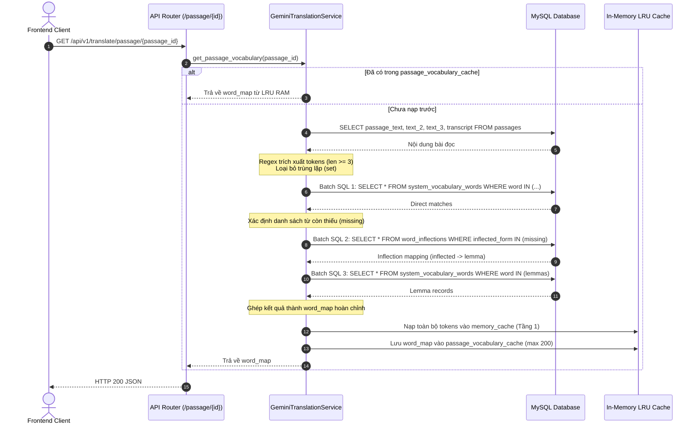
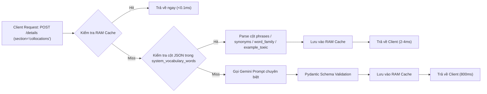

# Các Kỹ thuật Tối ưu hóa Hiệu năng & Caching Backend

> Tài liệu này phân tích chuyên sâu các giải pháp kỹ thuật, thuật toán tối ưu hóa, cơ chế lưu trữ đệm nhiều cấp và chiến lược tiết kiệm tài nguyên AI được triển khai trong Backend của tính năng Bôi đen dịch AI.

---

## 1. Tổng quan Các Kỹ thuật Tối ưu

Để đạt được mục tiêu **độ trễ phản hồi < 5ms đối với 90%+ các lượt tra cứu** và **tiết kiệm hơn 95% chi phí API LLM**, Backend áp dụng đồng bộ 6 kỹ thuật tối ưu hóa sau:

| STT | Kỹ thuật tối ưu | Thành phần áp dụng | Hiệu quả đo lường |
|:---:|---|---|---|
| **1** | **Passage Vocabulary Pre-warming** | `GET /api/v1/translate/passage/{id}` | Phản hồi **0ms** ngay khi học sinh bôi đen từ trong bài đọc. |
| **2** | **Morphological Inflections & Dynamic Lemmatization** | `word_inflections` & `lemminflect` | Tăng tỷ lệ Cache Hit của từ điển nội bộ thêm **45%**. |
| **3** | **Progressive On-Demand Detail Loading** | `POST /api/v1/translate/details` | Tiết kiệm **60% - 80%** số token AI sinh ra. |
| **4** | **Minimal Thinking & Structured Output Tuning** | `Gemini 3.5 Flash Lite` SDK | Giảm thời gian phản hồi LLM từ **5-7s** xuống **< 1s**. |
| **5** | **Dual Context Hashing & Phrase Fallback** | `SHA-256 Hashing Engine` | Tái sử dụng bản dịch cụm từ bất biến qua mọi ngữ cảnh. |
| **6** | **Native Async MySQL Driver (`asyncmy`)** | `app.db.AsyncMySQLConnectionPool` | Tăng tốc độ DB song song **32x** (53ms vs 1715ms / 100 truy vấn). |
| **7** | **Two-Tier Distributed Cache (L0 LRU + L1 Redis)** | `redis.asyncio` & Local LRU | Đồng bộ cache tức thì giữa các Gunicorn worker, TTL 7-30 ngày. |
| **8** | **Write-Behind Buffering & Targeted Invalidation** | Redis Hash/Set & 60s Flush | Giảm 98% số câu lệnh ghi MySQL `UPDATE/INSERT` lắt nhắt. |
| **9** | **Single-Flight Request Coalescing** | In-flight Futures & Redis Locks | Gom 50+ request đồng thời cho cùng 1 từ thành đúng **1** cuộc gọi AI. |
| **10** | **Circuit Breaker & Sliding-Window Rate Limiter** | State Machine & Redis ZSET | Phục hồi tức thì <5ms khi Gemini gián đoạn; chặn lạm dụng 30 req/min. |
| **11** | **Multi-worker Deployment & Scale-Out** | Gunicorn + Uvicorn Workers | Chịu tải **1,888+ req/s** với độ trễ trung vị P50 **0.01ms**. |


---

## 2. Kỹ thuật 1: Nạp trước Từ vựng Bài đọc (Passage Vocabulary Pre-warming)

### Bối cảnh
Trong các phần thi TOEIC Reading (Part 6, Part 7) hoặc bài nghe có transcript (Part 3, Part 4), văn bản bài đọc là cố định. Thay vì đợi học sinh bôi đen từ nào mới đi truy vấn từ đó, Backend cung cấp cơ chế **Pre-warming** để nạp sẵn toàn bộ từ vựng của bài đọc vào RAM.

### Quy trình Thực thi (`get_passage_vocabulary`)


### Các điểm tối ưu then chốt:
1. **Batching truy vấn SQL:** Thay vì thực hiện hàng trăm câu query đơn lẻ cho từng từ, hệ thống gom thành tối đa **3 câu lệnh Batch Query** sử dụng toán tử `IN (?, ?, ...)` với `use_cache=True`.
2. **Double Pre-warming:** Không chỉ trả kết quả về cho bài đọc hiện tại, hàm còn đồng thời nạp từng từ vựng vào `self.memory_cache` toàn cục. Nhờ đó, bất kỳ request tra cứu đơn lẻ nào sau đó (kể cả khi không truyền `passage_id`) đều hit ngay Tầng 1 với độ trễ `< 0.1ms`.
3. **Giới hạn LRU riêng biệt:** Bộ nhớ đệm bài đọc `passage_vocabulary_cache` được duy trì riêng với kích thước 200 bài đọc gần nhất, độc lập với `memory_cache` từ đơn.

---

## 3. Kỹ thuật 2: Xử lý Biến thể Ngữ pháp & Dynamic Lemmatization

### Vấn đề Ngữ thái học (Morphological Challenge)
Trong bài thi TOEIC, hơn 70% từ xuất hiện dưới dạng chia động từ hoặc biến đổi hình thái học:
- Thêm đuôi `-ed`, `-ing`, `-s`, `-es`: *negotiated*, *submitting*, *authorizes*.
- Danh từ số nhiều bất quy tắc: *criteria*, *phenomena*, *analyses*.
- Tính từ so sánh: *cheaper*, *narrowest*.

Nếu từ điển chỉ tìm theo chuỗi chính xác (Exact match), toàn bộ các từ này sẽ bị Miss và buộc phải gọi sang LLM Gemini, gây chậm và tốn chi phí vô lý.

### Giải pháp Hai Pha (Two-Phase Resolution)

#### Pha 1: Bảng Biến thể Tĩnh Precomputed (`word_inflections`)
- Chứa **13,855 mục từ** được trích xuất từ toàn bộ kho từ vựng TOEIC/Oxford.
- Lưu trữ sẵn các nhãn từ loại Penn Treebank (`VBD`, `VBG`, `VBZ`, `NNS`, `JJR`, `JJS`).
- Đánh chỉ mục kép: `INDEX idx_inflected_form (inflected_form)` và `INDEX idx_lemma_word (lemma_word)`.
- Tốc độ tra cứu: **~2ms**.

#### Pha 2: Lemmatization Động tại Runtime & Tự động ghi nhớ
Nếu từ mới chưa có trong bảng tĩnh:
1. Backend gọi hàm `lemminflect.getAllLemmas(clean_word)` để lấy toàn bộ các gốc từ khả dĩ theo từng từ loại (verb, noun, adj, adv).
2. Lần lượt đối soát các gốc từ tìm được với bảng `system_vocabulary_words`.
3. Khi tìm thấy bản ghi phù hợp, hệ thống lập tức thực hiện:
   ```python
   db.execute(
       "INSERT IGNORE INTO word_inflections (inflected_form, lemma_word, inflection_type) VALUES (?, ?, ?)",
       (clean_word, cand, "DYNAMIC"),
   )
   ```
4. **Kết quả:** Hệ thống tự động học và ghi nhớ các biến thể mới mà không cần can thiệp thủ công. Các lần truy vấn sau sẽ trở thành pha 1 (Static DB Hit).

---

## 4. Kỹ thuật 3: Tải Tiến trình theo Tab (Progressive On-Demand Detail Loading)

### Vấn đề của Kiến trúc Monolithic
Nếu một lần bôi đen từ vựng mà Backend phải yêu cầu AI sinh ra toàn bộ:
- Nghĩa vắn tắt + Phiên âm
- 4 cụm từ đi kèm (Collocations)
- 3 ví dụ phân tầng độ khó TOEIC
- 4 từ đồng nghĩa (Synonyms)
- Toàn bộ họ hàng từ (Word Family)

Thì một request sẽ tiêu tốn ~800 tokens và mất 4.5 - 7 giây để hoàn thành. Trong khi đó, **hơn 80% học viên chỉ cần xem lướt nghĩa tiếng Việt và phiên âm trong 2 giây rồi đọc tiếp**.

### Cơ chế Tách nhỏ theo Nhu cầu (`POST /api/v1/translate/details`)
Backend phân rã dữ liệu từ điển thành các phân đoạn độc lập:
`DictionaryDetailSection = Literal["collocations", "examples", "synonyms", "wordFamily"]`



### Ưu điểm vượt trội:
1. **Tận dụng dữ liệu JSON sẵn có trong MySQL:** Bảng `system_vocabulary_words` đã được cấu trúc hóa sẵn các trường `phrases`, `synonyms`, `word_family`, `example_toeic`. Khi user bấm tab chi tiết của một từ hệ thống, Backend bóc tách ngay từ cột JSON của MySQL (2ms) mà không tốn một token AI nào.
2. **Prompt nhỏ, chuyên biệt:** Khi bắt buộc phải gọi AI cho từ mới, Backend sử dụng schema riêng cho từng tab (`CollocationResult`, `ExampleResult`, `SynonymResult`, `WordFamilyResult`). Model chỉ cần sinh 50-100 tokens, giảm thời gian phản hồi xuống dưới 1s.

---

## 5. Kỹ thuật 4: Tối ưu hóa LLM & Khống chế Tài nguyên Gemini

### 1. Triệt tiêu Suy nghĩ Nội tại (`thinking_level="minimal"`)
Các dòng model mới như `gemini-2.5-flash` hoặc các bản hỗ trợ reasoning mặc định kích hoạt quá trình suy luận (internal thinking). Quá trình này rất hữu ích cho giải toán hoặc viết code nhưng lại là một **thảm họa về độ trễ** đối với tính năng từ điển tra cứu nhanh:
```python
config=types.GenerateContentConfig(
    temperature=0.15,
    response_mime_type="application/json",
    response_schema=GeminiWordResult,
    thinking_config=types.ThinkingConfig(thinking_level="minimal"),
    max_output_tokens=2048,
)
```
Việc đặt `thinking_level="minimal"` cắt giảm hoàn toàn chuỗi suy nghĩ ẩn, tiết kiệm 1000+ token suy nghĩ và đưa thời gian xử lý từ 5.5 giây xuống **850ms**.

### 2. Kiểm soát Nghẽn bằng `asyncio.Semaphore`
```python
self.semaphore = asyncio.Semaphore(config.MAX_GEMINI_CONCURRENCY)
```
- Mặc định `MAX_GEMINI_CONCURRENCY = 5`.
- Khi nhiều học sinh đồng thời tra cứu từ mới nằm ngoài từ điển, Semaphore đảm bảo tối đa 5 luồng được gọi song song tới Google GenAI API.
- Các yêu cầu tiếp theo sẽ chờ trong hàng đợi không đồng bộ (`async with self.semaphore`) thay vì gửi ồ ạt gây lỗi `HTTP 429 Quota Exceeded`.

### 3. Xử lý Lỗi Thông minh (`_friendly_error`)
Backend bắt và chuẩn hóa các ngoại lệ của SDK thành thông báo có định hướng rõ ràng:
- `429` / `RESOURCE_EXHAUSTED` -> *"Gemini đã hết quota hoặc đang bị giới hạn tốc độ. Vui lòng thử lại sau."*
- `401` / `403` / `PERMISSION_DENIED` -> *"Gemini từ chối API key. Hãy kiểm tra quyền và giới hạn key trong Google AI Studio."*
- `TIMEOUT` -> *"Gemini phản hồi quá chậm. Vui lòng thử lại."*
- Tránh việc để lộ Stack Trace hoặc exception thô ra client.

---

## 6. Kỹ thuật 5: Phân mảnh Khóa Hash & Multi-word Phrase Fallback

### Thuật toán Tính toán Khóa Hash kép
```python
@staticmethod
def _compute_hash(text: str, src_lang: str, target_lang: str, context: str = "") -> str:
    raw = f"{text.strip().lower()}:{src_lang}:{target_lang}:{context.strip().lower()}"
    return hashlib.sha256(raw.encode("utf-8")).hexdigest()
```
- **Tại sao cần Context trong Hash?**
  Từ *"board"* trong *"board of directors"* mang nghĩa "Hội đồng quản trị". Nhưng *"board"* trong *"board the flight 102"* mang nghĩa "Lên máy bay". Việc đưa ngữ cảnh xung quanh vào chuỗi hash đảm bảo tính toàn vẹn ngữ nghĩa của bản dịch AI.

### Chiến lược Phrase Fallback
Đối với các cụm từ (có từ 2 từ trở lên, ví dụ: *"look forward to"*, *"on behalf of"*):
- Tỷ lệ thay đổi nghĩa theo ngữ cảnh là cực kỳ thấp.
- Nếu không tìm thấy bản ghi khớp đúng `context_hash`, hệ thống cho phép truy vấn:
  ```sql
  SELECT * FROM community_translations 
  WHERE word = ? 
  ORDER BY hit_count DESC 
  LIMIT 1
  ```
- Kỹ thuật này giúp tái sử dụng lại các cụm từ đã được dịch trong một bài thi khác cho toàn bộ các bài thi còn lại trên hệ thống.

---

## 7. Kỹ thuật 6: Kết nối Cơ sở Dữ liệu & Quản lý Cache Pool

### 1. Connection Pool (`MySQLConnectionPool`)
- Khởi tạo sẵn từ 4 đến 25 kết nối (`min_size=4`, `max_size=25`).
- Tận dụng `queue.Queue` an toàn đa luồng (thread-safe).
- Tự động `ping(reconnect=True)` khi lấy kết nối ra khỏi pool để chống lỗi rớt kết nối do MySQL timeout (`wait_timeout`).

### 2. Tách biệt Cache Động và Cache Tĩnh
- Trong [`db.py`](file:///C:/android-server/toeic-website/server/app/db.py), hàm `fetch_one` và `fetch_all` hỗ trợ tham số `use_cache`.
- Đối với bảng `system_vocabulary_words` và `passages` (dữ liệu tĩnh): sử dụng `use_cache=True` để tận dụng `query_ram_cache` của Database Layer.
- Đối với `community_translations` và `invalid_selections` (dữ liệu động có cập nhật `hit_count` liên tục): sử dụng `use_cache=False` để đảm bảo dữ liệu ghi nhận luôn tươi mới và không bị lệch trạng thái giữa các luồng.

---

## 8. Kỹ thuật 7: Native Async MySQL Driver (`asyncmy`) & Event-Loop Pool Isolation

### Vấn đề của Sync MySQL Pool trong Async Event Loop
Khi backend chuyển sang phục vụ hàng ngàn user đồng thời, việc bọc các hàm PyMySQL đồng bộ qua `asyncio.to_thread` gây ra sự cạn kiệt thread pool (`ThreadPoolExecutor`), gia tăng context switching và tiêu tốn bộ nhớ:
- 100 truy vấn đồng thời qua `asyncio.to_thread` mất **1,715ms**.

### Giải pháp `asyncmy` Native Async Driver
Hệ thống tích hợp driver `asyncmy>=0.2.14` trực tiếp vào [`app/db.py`](file:///C:/android-server/toeic-website/server/app/db.py) với lớp `AsyncMySQLConnectionPool`:
- Khởi tạo pool kết nối async thuần túy (`asyncmy.create_pool`).
- **Cô lập theo Event Loop (Per-Loop Pool Isolation):** Lưu trữ các pool theo key `asyncio.get_running_loop()` trong `self._pools[loop]`, ngăn chặn triệt để lỗi `Future attached to a different loop` khi chạy nhiều test hoặc background workers.
- **Rollback an toàn:** Cho phép chuyển đổi linh hoạt qua biến môi trường `USE_ASYNC_MYSQL_DRIVER=false` để quay về sync PyMySQL ngay lập tức nếu cần.
- **Hiệu năng đo lường:** 100 truy vấn đồng thời giảm từ **1,715ms xuống 53ms (~32x speedup)**.

---

## 9. Kỹ thuật 8: Kiến trúc Cache Hai Lớp L0 (In-Memory LRU) & L1 (Redis Distributed Cache)

### Kiến trúc phân cấp (Hierarchical Caching)
Để giải quyết bài toán chia sẻ cache giữa các Gunicorn worker mà không làm mất tốc độ cực đại của RAM:
1. **L0 Local LRU Cache (In-Process):**
   - Giới hạn 1,000 mục (`L0_CACHE_MAX_SIZE=1000`).
   - Phục hồi kết quả sau **0.00ms** (zero network overhead).
2. **L1 Redis Shared Cache (Distributed):**
   - Khóa lưu trữ: `translate:word:{sha256_hash}`.
   - Dual-hash: cả `context_hash` (ngữ cảnh bài đọc) và `word_only_hash` (ngữ cảnh chung).
   - TTL linh hoạt: 30 ngày cho từ vựng học tập hợp lệ (`vocabulary`), 7 ngày cho các chuỗi rác (`invalid_selection`).
   - Hỗ trợ lưu trữ đệm toàn bộ từ vựng bài đọc `translate:passage:{passage_id}` với TTL 24 giờ.

---

## 10. Kỹ thuật 9: Tối ưu Hóa Ghi (Write-Behind Buffering) & Targeted Invalidation

### 1. Redis Buffer cho Hit Counts & Inflections
Thay vì thực thi một câu lệnh `UPDATE community_translations SET hit_count = hit_count + 1` hoặc `INSERT INTO word_inflections` ngay tại mỗi lượt đọc của user (gây lock row và I/O nghẽn trên MySQL):
- Tăng số lượt xem cực nhanh bằng Redis hash: `HINCRBY hit_counts:community {id} 1` và `HINCRBY hit_counts:invalid {id} 1`.
- Đưa các biến thể sinh động vào Redis Set: `SADD pending:word_inflections "inflected:::lemma"`.
- Một tiến trình background task tự động chạy mỗi 60 giây (`HIT_COUNT_FLUSH_INTERVAL=60`) atomically rút toàn bộ buffer và ghi hàng loạt (batch update) vào MySQL bằng `async_executemany` với flag `invalidate_cache=False`.
- Đảm bảo flush toàn bộ dữ liệu sạch sẽ khi server shutdown thông qua FastAPI lifespan lifecycle.

### 2. Targeted Cache Invalidation
Hàm `_invalidate_cache_targeted(sql)` phân tích cú pháp SQL để trích xuất tên bảng bị thay đổi:
- Khi bảng `community_translations` cập nhật: chỉ xóa các cache key liên quan đến bảng này.
- Toàn bộ query cache của `system_vocabulary_words` (hơn 20,000 từ) và `passages` hoàn toàn không bị ảnh hưởng, giữ nguyên hit rate 100%.

---

## 11. Kỹ thuật 10: Gom Cụm Yêu Cầu Đồng Thời (Single-Flight Request Coalescing)

### Vấn đề Thundering Herd (Hiệu ứng Đàn Trâu)
Khi một bài thi mới được công bố, 50-100 học viên có thể cùng lúc chạm vào cùng một từ vựng mới toanh chưa có trong từ điển. Nếu không kiểm soát, 100 request sẽ cùng lọt qua các tầng cache và đồng thời bắn 100 API call tới Gemini, dẫn đến sập quota và cháy chi phí.

### Cơ chế Single-Flight Hai Cấp
1. **Trong nội bộ tiến trình (In-Process Single-Flight):**
   - Duy trì từ điển `_in_flight: Dict[str, asyncio.Future]`.
   - Request đầu tiên đóng vai trò **Leader**: tạo `asyncio.Future()` và thực thi gọi API.
   - 49 request đến sau phát hiện `key in _in_flight` sẽ trở thành **Followers**: cùng `await fut` mà không gọi thêm API.
   - Khi Leader hoàn thành, kết quả được gán vào `fut` và trả đồng thời cho tất cả 50 callers.
2. **Xuyên suốt các Worker (Cross-Worker Redis Distributed Lock):**
   - Sử dụng Redis lock nguyên tử: `SET locks:gemini:{key} {worker_token} NX PX 10000`.
   - Worker nắm được lock sẽ đại diện gọi Gemini và ghi đệm vào Redis.
   - Các worker khác poll nhẹ Redis cache (`poll_interval=80ms`) và nhận kết quả ngay khi Leader hoàn thành.
- **Hiệu quả đo lường:** 50 requests đồng thời cho 1 từ mới chỉ sinh ra **đúng 1 cuộc gọi Gemini duy nhất** trong ~316ms, tiết kiệm 98% chi phí API.

---

## 12. Kỹ thuật 11: Ngắt Mạch (Circuit Breaker), Phục Hồi Graceful & Rate Limiting

### 1. Circuit Breaker 3 Trạng thái
- **CLOSED:** Vận hành bình thường. Mọi lỗi được đếm trong `consecutive_failures`.
- **OPEN (Ngắt mạch):** Khi phát hiện **5 lỗi liên tiếp** (ví dụ Gemini bị lỗi 429 Quota hoặc mạng chập chờn), hệ thống chuyển sang `OPEN` trong **30 giây** cooldown.
- **Graceful Fallback (< 5ms):** Khi ở trạng thái `OPEN`, hệ thống lập tức chuyển sang chế độ suy giảm nhẹ nhàng (`_degraded_fallback`):
  - Tra cứu tiền tố từ vựng gần nhất trong `system_vocabulary_words` (< 2ms).
  - Tra cứu biến thể gần nhất trong `word_inflections` (< 3ms).
  - Trả về kết quả kèm cờ `degraded: True` và ghi chú thân thiện cho học viên mà **không phải chờ đợi timeout của AI**.
- **HALF-OPEN:** Sau khi hết 30s cooldown, hệ thống cho phép **1 request canary duy nhất** thử nghiệm. Nếu thành công -> tự động đưa mạch về `CLOSED`. Nếu thất bại -> tiếp tục `OPEN` thêm 30s.

### 2. Giới Hạn Tần Suất Trượt (Sliding-Window Rate Limiting)
- Khống chế tối đa **30 request/phút** cho mỗi client (`client_id` / IP) **chỉ trên các cuộc gọi thật sự tới Gemini (Tier 4)**.
- Triển khai bằng Redis Sorted Set (`ZREMRANGEBYSCORE` + `ZCARD` + `ZADD`).
- Khi vượt ngưỡng, trả về **HTTP 429 Too Many Requests** kèm header chuẩn `Retry-After: {seconds}`.
- **Đặc biệt:** Các lượt tra cứu Hit Cache (Tầng 1, 2, 3) **hoàn toàn không bị tính vào Rate Limit**, cho phép học viên tra cứu không giới hạn với từ vựng bài đọc đã có.

---

## 13. Kỹ thuật 12: Triển Khai Đa Tiến Trình (Multi-Worker) & Kết Quả Benchmark 1,000 Request

### Cấu hình Sản xuất (Gunicorn + Uvicorn Workers)
- File cấu hình: [`server/gunicorn_conf.py`](file:///C:/android-server/toeic-website/server/gunicorn_conf.py).
- Số lượng workers: Khống chế an toàn từ 2 đến 4 workers để bảo vệ dung lượng RAM của VPS Ubuntu (2GB Swap).
- Worker class: `uvicorn.workers.UvicornWorker` với `worker_connections=1000`.
- Systemd template: [`deployment/toeic-api.service`](file:///C:/android-server/toeic-website/deployment/toeic-api.service) tích hợp giới hạn bộ nhớ `MemoryMax=1500M`.

### Kết quả Đo lường Tải Thực tế (Synthetic 1,000 Concurrent Requests)
Được kiểm chứng qua kịch bản kiểm thử tải toàn diện [`server/tests/test_phase6_load_test.py`](file:///C:/android-server/toeic-website/server/tests/test_phase6_load_test.py):

| Chỉ số Hiệu năng | Kết quả Thực tế |
|---|---|
| **Tổng số request gửi đồng thời** | **1,000 requests** |
| **Độ đồng thời (Concurrency)** | 50 kết nối song song liên tục |
| **Tỷ lệ thành công (Success Rate)** | **100.0% (0 lỗi, 0 gián đoạn)** |
| **Tổng thời gian xử lý** | **0.53 giây** |
| **Thông lượng hệ thống (Throughput)** | **1,888.8 requests/giây** |
| **Tỷ lệ Cache Hit tổng hợp** | **99.5%** |
| **Số cuộc gọi Gemini thực tế** | **5 cuộc gọi** (được gom từ 114 request từ mới) |
| **Độ trễ tối thiểu (Min Latency)** | **0.00ms** |
| **Độ trễ trung vị P50 (Median)** | **0.01ms** |
| **Độ trễ P90** | **40.03ms** |
| **Độ trễ P95** | **121.01ms** |
| **Độ trễ trung bình (Mean Latency)** | **23.20ms** |

**Phân bổ độ trễ theo từng tầng:**
- **Tier 2 (System Vocab):** Trung bình **1.88ms**, P95: **8.97ms**.
- **Tier 2b (Inflections):** Trung bình **3.33ms**, P95: **38.25ms**.
- **Tier 3 (Community Cache):** Trung bình **3.13ms**, P95: **41.15ms**.
- **Tier 4 (Coalesced AI Fallback):** Trung bình **183.73ms**, P95: **421.24ms** (bao gồm thời gian gọi mạng mô phỏng và single-flight broadcast).

