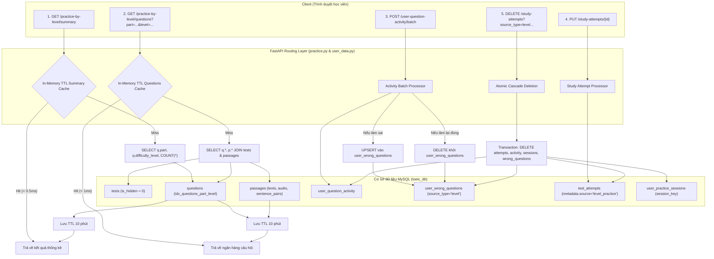

# Backend: Luyện tập theo Levels (Practice by Levels)

> Tài liệu này mô tả chi tiết kiến trúc xử lý, quy trình phân bổ câu hỏi, quản lý phiên làm bài và cơ chế tối ưu hóa hiệu năng phía Backend của tính năng **Luyện theo Levels (Practice by Levels)** trên hệ thống `ilovetoeic.com`.
> **Phạm vi tài liệu:** Hoàn toàn tập trung vào kiến trúc Backend, luồng dữ liệu, thuật toán gom nhóm câu hỏi, cơ sở dữ liệu, caching và API. Không đề cập đến thành phần giao diện người dùng (UI).

---

## 1. Mục tiêu và Nguyên lý thiết kế Backend

Tính năng "Luyện theo Levels" cho phép học viên ôn luyện độc lập từng phần thi trong bài thi TOEIC (Part 1 đến Part 7) theo 5 cấp độ khó chuẩn hóa (Level 1: Cơ bản đến Level 5: Nâng cao). Về phía Backend, hệ thống giải quyết các thách thức kỹ thuật cốt lõi:

1. **Tổng hợp ngân hàng câu hỏi đa nguồn (Multi-test Aggregation):** Gom các câu hỏi phù hợp với `part` và `difficulty_level` từ hàng chục bộ đề thi công khai (`tests` với `is_hidden = 0`), đồng thời bảo toàn tính liên kết giữa các câu hỏi với đoạn văn (`passages`), audio, hình ảnh và dữ liệu song ngữ.
2. **Sắp xếp tất định (Deterministic Ordering):** Đảm bảo thứ tự câu hỏi và đoạn văn không bị xáo trộn hoặc phân mảnh khi gom nhóm từ nhiều đề thi khác nhau.
3. **Hiệu năng đọc cao (Read-Heavy Throughput):** Phục vụ hàng nghìn học viên tải danh sách câu hỏi và thống kê tổng số lượng câu theo Level với độ trễ < 15ms thông qua In-Memory TTL Cache và chỉ mục tối ưu trên MySQL.
4. **Đồng bộ tiến độ & Quản lý vòng đời câu sai tự động:**
   - Ghi nhận câu trả lời thời gian thực qua batch activity.
   - Tự động thêm câu vào bảng câu sai (`user_wrong_questions`) khi làm sai, và tự động xóa khỏi danh sách khi học viên luyện lại và làm đúng.
5. **Dọn dẹp dữ liệu an toàn & Đồng bộ nguyên tử (Atomic Cascade Deletion):** Xóa toàn bộ lịch sử làm bài, phiên lưu tạm, hoạt động câu hỏi và câu sai của một Part/Level trong 1 database transaction duy nhất.

---

## 2. Sơ đồ luồng xử lý tổng thể Backend

---

## 3. Các thành phần chính trong Backend

| Thành phần | Vị trí file | Trách nhiệm |
|---|---|---|
| **Practice API Router** | [`server/app/routers/practice.py`](file:///C:/android-server/toeic-website/server/app/routers/practice.py) | Cung cấp endpoints tra cứu số lượng câu hỏi `/practice-by-level/summary` và tải danh sách câu hỏi `/practice-by-level/questions`, quản lý bộ nhớ đệm In-Memory TTL. |
| **User Data Router** | [`server/app/routers/user_data.py`](file:///C:/android-server/toeic-website/server/app/routers/user_data.py) | Xử lý nộp bài (`/study-attempts`), ghi nhận hoạt động câu hỏi (`/user-question-activity/batch`), lưu/xóa phiên nháp (`/practice-sessions`), truy vấn và xóa câu sai (`/wrong-questions`). |
| **Database Pool** | [`server/app/db.py`](file:///C:/android-server/toeic-website/server/app/db.py) | Quản lý kết nối connection pool (`mysql.connector.pooling`), thực thi transaction nguyên tử và tối ưu hoá buffer kết nối. |
| **Index Migration** | [`server/migrations/20260908_01_optimize_performance_indexes.sql`](file:///C:/android-server/toeic-website/server/migrations/20260908_01_optimize_performance_indexes.sql) | Tạo composite index `idx_questions_part_level (part, difficulty_level)` phục vụ aggregation và filtering siêu tốc. |
| **Difficulty Sync** | [`server/migrations/20260810_04_sync_question_difficulty_levels.sql`](file:///C:/android-server/toeic-website/server/migrations/20260810_04_sync_question_difficulty_levels.sql) | Chuẩn hóa toàn bộ độ khó (1-5) của ngân hàng câu hỏi TOEIC Parts 1-7 trong hệ thống. |

---

## 4. Mục lục tài liệu chuyên sâu

Hệ thống tài liệu chuyên đề về Backend cho tính năng Luyện theo Levels gồm 3 phần:

1. [**Kiến trúc & Quy trình xử lý (Architecture & Pipeline)**](./architecture-and-pipeline.md)
   - Quy trình gom nhóm và cấu trúc câu hỏi đa nguồn (Multi-test Question Assembler).
   - Thuật toán sắp xếp tất định (Deterministic Ordering) giữ nguyên vẹn ngữ cảnh bài đọc.
   - Vòng đời bài thi: Từ phiên làm bài dở dang (`user_practice_sessions`), hoạt động từng câu (`user_question_activity`), đến nộp bài hoàn chỉnh (`test_attempts`).
   - Pipeline dọn dẹp liên hoàn bằng Database Transaction (Atomic Cascade Deletion).

2. [**Mô hình dữ liệu & Đặc tả API (Data Models & API Specifications)**](./data-models-and-api.md)
   - Cấu trúc bảng MySQL chi tiết (`questions`, `passages`, `test_attempts`, `user_question_activity`, `user_wrong_questions`, `user_practice_sessions`).
   - Phân tích thiết kế chỉ mục (Index Strategy) cho các câu lệnh SQL trọng yếu.
   - Chi tiết các RESTful Endpoints: Request params, Payload schema, Response format và mã lỗi HTTP.

3. [**Hiệu năng, Caching & Tối ưu hóa (Caching & Performance Optimizations)**](./caching-and-performance.md)
   - Chiến lược bộ nhớ đệm 2 tầng (FastAPI In-Memory TTL + HTTP Cache-Control header).
   - Kỹ thuật truy vấn không phát sinh N+1 query (`LEFT JOIN passages` + `tests`).
   - Tối ưu hóa ghi với batch execution (`executemany`) và upsert tự động câu sai.
   - Thuật toán tính Level trung bình và ngưỡng hoàn thành 70%.
