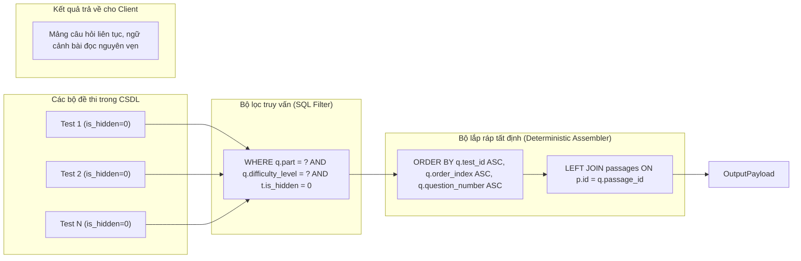
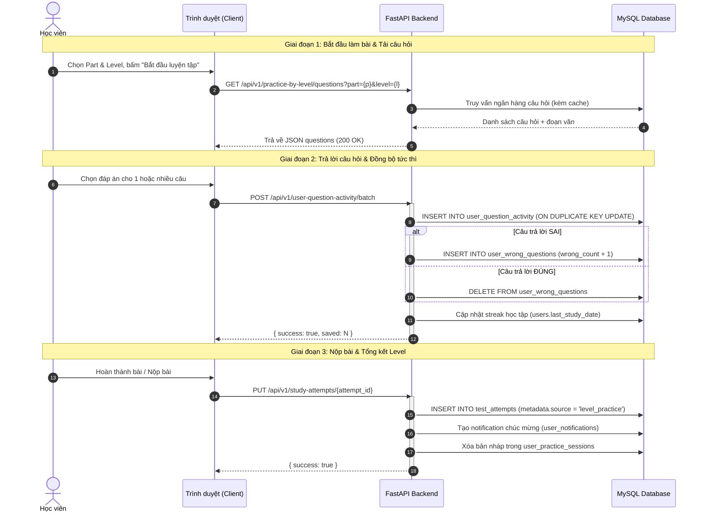
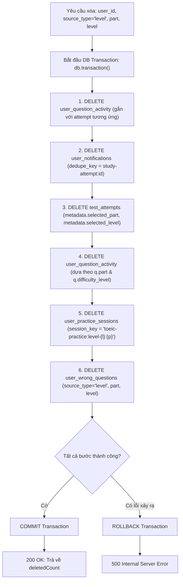

# Kiến trúc & Quy trình xử lý: Luyện theo Levels (Practice by Levels)

> Tài liệu này mô tả chuyên sâu về quy trình phân giải câu hỏi đa nguồn, thuật toán sắp xếp tất định, cơ chế đồng bộ hoạt động và vòng đời dữ liệu trong tính năng **Luyện theo Levels**.

---

## 1. Pipeline gom nhóm câu hỏi đa nguồn (Multi-Test Question Assembler)

Trong chế độ làm bài thi thử thông thường (Full Test hoặc Single Test Part), toàn bộ câu hỏi đều xuất phát từ một đề thi duy nhất (`test_id`). Ngược lại, **Luyện theo Levels** tổng hợp câu hỏi từ toàn bộ ngân hàng đề thi của hệ thống nhằm tập hợp đầy đủ các câu hỏi có cùng độ khó:



### Thách thức kỹ thuật đối với câu hỏi theo nhóm (Passage-based Questions)

Các phần thi Part 3, Part 4 (Listening) và Part 6, Part 7 (Reading) có cấu trúc dạng **cụm câu hỏi đi kèm bài đọc/đoạn hội thoại**:
- Một bài hội thoại hoặc bài đọc thường có từ 2 đến 5 câu hỏi liên quan.
- Nếu câu hỏi được lấy ngẫu nhiên (`ORDER BY RAND()`) hoặc chỉ gom theo `question_id`, các câu hỏi thuộc cùng một bài đọc sẽ bị xé lẻ. Khi hiển thị, người dùng sẽ phải đọc lại cùng một đoạn văn nhiều lần một cách rời rạc, làm vỡ trải nghiệm bài thi chuẩn hóa.

### Thuật toán sắp xếp tất định (Deterministic Ordering)

Để giải quyết triệt để vấn đề này, Backend áp dụng mệnh đề sắp xếp 3 cấp:

```sql
ORDER BY q.test_id ASC, q.order_index ASC, q.question_number ASC
```

1. **`q.test_id ASC`:** Gom toàn bộ các câu hỏi thuộc cùng một đề thi lại với nhau.
2. **`q.order_index ASC`:** Đảm bảo thứ tự xuất hiện của các cụm bài đọc (Passage Groups) diễn ra đúng trình tự thiết kế trong đề gốc.
3. **`q.question_number ASC`:** Bảo toàn thứ tự tự nhiên của các câu hỏi nhỏ trong cùng một bài đọc.

Nhờ chiến lược này, câu hỏi giữa các đề khác nhau không bao giờ bị đan xen ngẫu nhiên, các cụm bài đọc phức tạp (đoạn kép, đoạn ba của Part 7) luôn được giữ liền mạch nguyên vẹn.

---

## 2. Vòng đời hoạt động của học viên (Student Activity Lifecycle)

Hệ thống quản lý dữ liệu học viên trong quá trình luyện tập theo Level qua 3 giai đoạn đồng bộ:



### Chi tiết logic đồng bộ câu sai tự động (Self-Healing Wrong Question Mechanism)

Khi học viên làm bài theo Level, backend đảm bảo bảng `user_wrong_questions` luôn phản ánh chính xác các lỗ hổng kiến thức hiện tại:
- **Khi làm sai:** Câu hỏi được tự động ghi vào `user_wrong_questions` với nhãn `source_type = 'level'`, lưu kèm `part` và `level`. Nếu đã từng sai trước đó, biến đếm `wrong_count` được cộng dồn thêm 1 và cập nhật thời điểm `last_wrong_at`.
- **Khi luyện tập lại và làm đúng:** Ngay trong transaction của `/user-question-activity/batch`, backend lập tức thực thi câu lệnh:
  ```sql
  DELETE FROM user_wrong_questions
  WHERE user_id = %s AND question_id = %s AND source_type = %s
  ```
  Nhờ vậy, số lượng câu sai hiển thị trên giao diện Level (`RotateCcw badge`) tự động giảm đi mà không cần bất kỳ tiến trình quét dọn (cron job) chạy ngầm nào.

---

## 3. Pipeline dọn dẹp liên hoàn bằng Atomic Transaction (Cascade Deletion)

Khi học viên muốn xóa toàn bộ lịch sử và dữ liệu luyện tập của một Part + Level cụ thể (`DELETE /api/v1/study-attempts?source_type=level&part={part}&level={level}`), backend phải dọn dẹp sạch sẽ 5 bảng dữ liệu khác nhau nhằm tránh hiện tượng dữ liệu rác (orphan records):



### Đoạn mã thực thi trong [`server/app/routers/user_data.py`](file:///C:/android-server/toeic-website/server/app/routers/user_data.py)

```python
with db.transaction() as conn:
    with conn.cursor() as cursor:
        # 1. Xóa activity gắn với lượt nộp bài
        cursor.execute(
            """
            DELETE activity
            FROM user_question_activity activity
            INNER JOIN test_attempts attempt
                ON attempt.id = activity.attempt_id
               AND attempt.user_id = activity.user_id
            WHERE """ + attempt_where,
            tuple(attempt_params),
        )

        # 2. Xóa thông báo kết quả làm bài tương ứng
        cursor.execute(
            """
            DELETE notification
            FROM user_notifications notification
            INNER JOIN test_attempts attempt
                ON attempt.user_id = notification.user_id
               AND notification.dedupe_key = CONCAT('study-attempt:', attempt.id)
            WHERE """ + attempt_where,
            tuple(attempt_params),
        )

        # 3. Xóa bản ghi lịch sử nộp bài trong test_attempts
        cursor.execute(
            "DELETE attempt FROM test_attempts attempt WHERE " + attempt_where,
            tuple(attempt_params),
        )
        deleted_count = cursor.rowcount

        # 4. Xóa các hoạt động trả lời dở dang thuộc Part & Level đó
        cursor.execute(
            """
            DELETE activity
            FROM user_question_activity activity
            JOIN questions q ON q.id = activity.question_id
            WHERE activity.user_id = %s
              AND q.part = %s
              AND q.difficulty_level = %s
            """,
            (user_id, part, level),
        )

        # 5. Xóa các bản nháp phiên làm bài dở dang
        cursor.execute(
            """
            DELETE FROM user_practice_sessions
            WHERE user_id = %s
              AND (
                  (source_type = 'level' AND part_scope = %s AND level = %s)
                  OR session_key = %s
                  OR session_key LIKE %s
              )
            """,
            (user_id, str(part), level, f"toeic-practice:level-{level}:{part}", f"%level-{level}%:{part}"),
        )

        # 6. Dọn sạch ngân hàng câu sai của Part & Level này
        cursor.execute(
            """
            DELETE FROM user_wrong_questions
            WHERE user_id = %s AND source_type = 'level' AND part = %s AND level = %s
            """,
            (user_id, part, level),
        )
```

Việc bọc toàn bộ chuỗi xóa vào trong một transaction duy nhất đảm bảo tính toàn vẹn (ACID), không bao giờ để lại tình trạng xóa nửa chừng làm lệch dữ liệu thống kê của học viên.
