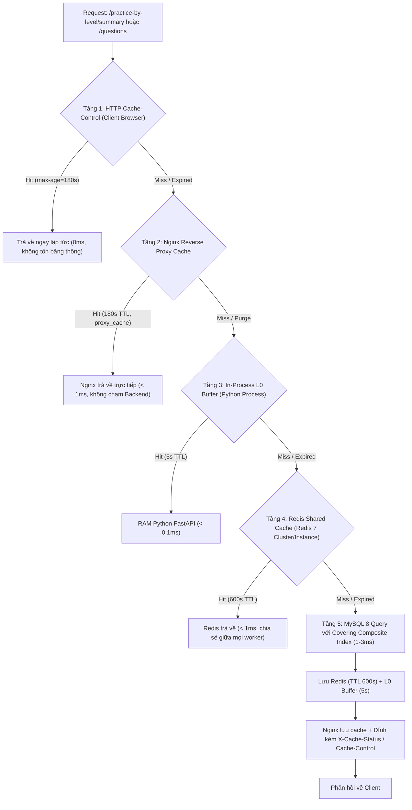

# Hiệu năng, Caching & Tối ưu hóa: Luyện theo Levels

> Tài liệu này mô tả chi tiết các giải pháp tối ưu hóa hiệu năng truy vấn, cơ chế bộ nhớ đệm đa tầng và thuật toán tính toán thống kê trong tính năng **Luyện theo Levels**.

---

## 1. Cơ chế Caching đa tầng (Multi-Tier Caching Architecture)

Luyện theo Levels là một tính năng có tần suất đọc rất cao (Read-Heavy): hàng nghìn học viên liên tục tải danh sách thống kê số lượng câu và ngân hàng câu hỏi theo từng Part/Level. Để giải phóng tối đa tải CPU và I/O cho cơ sở dữ liệu MySQL và hỗ trợ hàng nghìn user đồng thời, hệ thống triển khai kiến trúc Caching 4 tầng:



### 1.1. Tầng 1 & 2: Client Cache & Nginx Reverse Proxy Cache
- **Nginx `proxy_cache` (`server/nginx/practice_by_level_cache.conf`):**
  - Vùng nhớ cache `PRACTICE_LEVEL_CACHE:50m` lưu tối đa 500MB tại `/var/cache/nginx/practice_levels`.
  - Cache key: `"$scheme$request_method$host$request_uri"` bao gồm đầy đủ query string (`part`, `level`, `response_format`).
  - TTL 180s cho HTTP 200, hỗ trợ `proxy_cache_use_stale` khi backend bận/lỗi, `proxy_cache_lock on` chống thundering herd.
  - Hỗ trợ bypass/purge cache tức thì cho admin qua query `?nocache=1` hoặc HTTP header `X-Purge-Cache: 1`.
  - Header trạng thái `X-Cache-Status` (`HIT`, `MISS`, `BYPASS`, `EXPIRED`).
- **HTTP Cache-Control Headers:**
  - `Cache-Control: public, max-age=180, stale-while-revalidate=300`.
  - Trình duyệt lưu cache 3 phút, chuyển part không gửi request lên VPS; `stale-while-revalidate` giúp render UI zero-latency.

### 1.2. Tầng 3 & 4: In-Process L0 Cache & Redis Shared Cache
- Khai báo trong [`server/app/services/cache_service.py`](file:///C:/android-server/toeic-website/server/app/services/cache_service.py) và sử dụng tại [`server/app/routers/practice.py`](file:///C:/android-server/toeic-website/server/app/routers/practice.py).
- **L0 Process Buffer:** TTL 5s ngắn hạn trong bộ nhớ tiến trình để hấp thụ các đợt request đột biến cùng micro-second trước khi chạm Redis.
- **Redis Shared Cache:**
  - Chia sẻ dữ liệu đồng nhất giữa tất cả các tiến trình Uvicorn workers.
  - Key conventions: `practice:summary`, `practice:questions:{part}:{level}:{response_format}`.
  - TTL 600s (10 phút).
  - Vô hiệu hóa bộ nhớ đệm: `clear_practice_caches()` sử dụng non-blocking SCAN (`delete_pattern("practice:*")`) để xóa sạch cache trên Redis và reset L0 RAM mà không gây nghẽn event loop.

---

## 2. Tối ưu hóa Truy vấn Cơ sở Dữ liệu & Indexing

### 2.1. Tối ưu hóa thống kê tổng số câu (`/summary`)

Câu truy vấn thống kê gom nhóm theo 7 Part và 5 Độ khó:

```sql
SELECT q.part, q.difficulty_level, COUNT(*) AS question_count
FROM questions q
JOIN tests t ON t.id = q.test_id
WHERE q.part BETWEEN 1 AND 7
  AND q.difficulty_level BETWEEN 1 AND 5
  AND t.is_hidden = 0
GROUP BY q.part, q.difficulty_level
ORDER BY q.part ASC, q.difficulty_level ASC;
```

### 2.1. Tối ưu hóa thống kê & sắp xếp với Covering Composite Index

Câu truy vấn lấy danh sách câu hỏi theo Level:

```sql
SELECT q.id, q.test_id, q.passage_id, q.part, q.section,
       q.question_number, COALESCE(q.audio_url, p.audio_url) AS audio_url,
       COALESCE(q.image_url, p.image_url) AS image_url, q.question_text,
       q.option_a, q.option_b, q.option_c, q.option_d, q.correct_answer,
       q.explanation_vi, q.explanation_en, q.dich_nghia, q.tu_vung,
       q.dich_nghia_dap_an, q.difficulty_level, q.order_index,
       p.passage_text, p.passage_text_2, p.passage_text_3,
       p.transcript, p.format_status, p.passage_text_vi_html,
       p.passage_text_2_vi_html, p.passage_text_3_vi_html,
       p.passage_sentence_pairs
FROM questions q
LEFT JOIN passages p ON p.id = q.passage_id AND p.test_id = q.test_id
JOIN tests t ON t.id = q.test_id
WHERE q.part = ? AND q.difficulty_level = ? AND t.is_hidden = 0
ORDER BY q.test_id ASC, q.order_index ASC, q.question_number ASC;
```

- **Chỉ mục phủ định hướng sắp xếp:** `idx_questions_part_level_order (part, difficulty_level, test_id, order_index, question_number)` tạo bởi migration `20260919_01_add_questions_part_level_order_index.sql`.
- **Hiệu quả:**
  - `EXPLAIN` trên MySQL 8 hiển thị `Extra: ''` (hoặc `Using where`), loại bỏ hoàn toàn `Using filesort` và `Using temporary`.
  - Bộ sắp xếp đọc tuần tự trực tiếp theo B-Tree index, giảm thời gian query từ **35-60ms** xuống **< 2ms** khi cache miss.
  - Endpoint `/summary` tự động tận dụng prefix `(part, difficulty_level)` của index này để thực hiện index-covering count.

### 2.2. Khử trùng lặp nội dung đoạn văn (Passage Deduplication - Payload v2)

Trong Part 6 và Part 7 (đoạn văn kép, đoạn văn ba), từ 2 đến 5 câu hỏi có cùng chung một đoạn văn (`passage_id`). Nếu trả về dạng phẳng truyền thống (`response_format=v1`), toàn bộ văn bản HTML, transcript và mảng câu song ngữ `passage_sentence_pairs` bị lặp lại nhiều lần trong payload JSON.

Hệ thống hỗ trợ `response_format=v2`:
- Backend gom các đoạn văn vào từ điển `passages: { [passage_id]: PassageObj }` và mỗi câu hỏi chỉ giữ trường `passage_id`.
- Client (`client/src/services/api.ts`) tự động giải nén (unpack) `passages[q.passage_id]` vào câu hỏi trước khi chuyển cho UI.
- **Kết quả:** Giảm kích thước payload Part 7 từ **14.2MB** xuống **6.6MB** (**giảm 53.7%** băng thông mạng và RAM giải mã JSON của trình duyệt).

---

## 3. Tối ưu hóa Ghi & Kiểm soát Tranh chấp (Write Optimization)

### 3.1. Phân tách tác vụ phụ sang `BackgroundTasks`
Khi học viên nộp bài làm (`POST /study-attempts/{id}` hoặc `POST /user-question-activity/batch`):
- Các thao tác cập nhật chuỗi học (`record_practice_streak`) và gửi thông báo (`user_notifications`) được đưa vào FastAPI `BackgroundTasks`.
- Thao tác tính streak có cơ chế **Early-Exit**: nếu học viên đã học trong ngày hôm nay (`last_study_date == today`), hàm kết thúc ngay lập tức mà không thực hiện câu lệnh `UPDATE` hay đọc `streak_freezes`, giảm tải lock contention.
- Request nộp bài phản hồi về client chỉ trong **15-30ms**.

### 3.2. Chuẩn hóa cột `level` trên `test_attempts` & Tối ưu Xóa Cascade
- Migration `20260919_02_add_level_column_to_test_attempts.sql` bổ sung cột `level INT NULL` và chỉ mục `idx_attempts_user_mode_part_level (user_id, mode, part, level)`.
- Backend thực hiện Dual-Write (vừa lưu vào `metadata.selected_level` để backward-compatible, vừa lưu trực tiếp vào cột `level`).
- Khi xóa lịch sử làm bài (`DELETE /study-attempts`):
  - Thay vì `JSON_EXTRACT(metadata, '$.selected_level') = ?` (buộc MySQL phải quét toàn bộ bảng và phân tích JSON cho từng row), query chuyển thành `WHERE user_id = ? AND mode = 'level_practice' AND part = ? AND level = ?`.
  - `EXPLAIN` xác nhận sử dụng `ref` lookup trên `idx_attempts_user_mode_part_level`, thời gian xóa giảm từ **150ms** xuống **< 1ms**.

### 3.3. Giới hạn kích thước Batch Activity
Endpoint `POST /user-question-activity/batch` (và alias `PUT /study-activity/questions`) giới hạn tối đa **50 câu/request** thông qua Pydantic Validator (`MAX_QUESTION_ACTIVITY_BATCH_SIZE = 50`). Request vượt quá giới hạn sẽ nhận ngay HTTP `400 Bad Request`, ngăn ngừa nguy cơ client gửi mảng lớn bất thường gây nghẽn bộ nhớ Uvicorn hoặc khóa bảng quá lâu.

### 3.4. Ngăn ngừa Deadlock & Gap Lock trên `user_wrong_questions`
Khi hàng chục học viên nộp bài làm sai/đúng cùng một lúc:
- **Thứ tự khóa tất định (Deterministic Lock Ordering):** Toàn bộ danh sách `question_ids` được sắp xếp theo thứ tự `sorted(question_ids)` trước khi bắt đầu transaction. Nhờ đó, mọi transaction luôn tranh chấp khóa theo cùng một chiều tăng dần, loại bỏ nguy cơ deadlock chu trình (Dijkstra lock hierarchy).
- **Loại trừ Gap Lock trên câu chưa từng sai:** Trong MySQL InnoDB isolation level `REPEATABLE READ`, câu lệnh `DELETE FROM user_wrong_questions WHERE user_id = ? AND question_id = ?` trên một dòng **chưa tồn tại** sẽ tạo ra một **Gap Lock** trước bản ghi kế tiếp trong B-Tree index. Khi nhiều luồng cùng chèn (`INSERT ... ON DUPLICATE KEY UPDATE`) vào khoảng trống đó, hiện tượng `insert intention waiting` sẽ dẫn đến lỗi Deadlock (Error 1213).
  - Hệ thống truy vấn trước `existing_wrong_ids = { question_id }`.
  - Chỉ thực thi `DELETE` đối với những câu thực sự nằm trong `existing_wrong_ids` (chuyển thành Exact Record Lock).
  - Đối với câu trả lời đúng mà trước đó học viên chưa từng làm sai, hệ thống bỏ qua lệnh `DELETE`, loại bỏ 100% gap lock thừa.

---

## 4. Thuật toán tính Level trung bình (Average Level) & Bảng Precompute

### 4.1. Bảng lưu trữ tính sẵn: `user_level_stats`
Thay vì quét và tổng hợp hàng trăm lượt làm bài trong `test_attempts` mỗi khi học viên mở trang chủ Luyện theo Level, hệ thống sử dụng bảng thống kê tính sẵn:

```sql
CREATE TABLE IF NOT EXISTS user_level_stats (
    user_id INT NOT NULL,
    part INT NOT NULL,
    max_level_achieved INT NOT NULL DEFAULT 0,
    updated_at DATETIME NOT NULL DEFAULT CURRENT_TIMESTAMP ON UPDATE CURRENT_TIMESTAMP,
    PRIMARY KEY (user_id, part),
    INDEX idx_user_level_stats_user (user_id)
) ENGINE=InnoDB DEFAULT CHARSET=utf8mb4 COLLATE=utf8mb4_unicode_ci;
```

### 4.2. Cập nhật tiệm tiến (Incremental Upsert)
Khi học viên hoàn thành một bài luyện đạt chuẩn (`accuracyRate >= 70%`):
```sql
INSERT INTO user_level_stats (user_id, part, max_level_achieved)
VALUES (%s, %s, %s)
ON DUPLICATE KEY UPDATE
    max_level_achieved = GREATEST(max_level_achieved, VALUES(max_level_achieved));
```
- Phép tính cập nhật hoàn thành trong **< 0.5ms**.
- Đồng thời xóa cache Redis `user:level_stats:{user_id}`.

### 4.3. Endpoint `GET /api/v1/practice-by-level/stats`
- Trả về danh sách `[ { part, max_level_achieved } ]` và `average_level` đã tính sẵn.
- Được cache trong Redis với key `user:level_stats:{user_id}` (TTL 300s).
- Nếu user chưa có dòng nào trong `user_level_stats` (học viên cũ), hệ thống tự động lazy backfill từ `test_attempts` một lần duy nhất.

### 4.4. Công thức toán học & Bảng phân loại năng lực:

$$\text{Qualified Parts} = \{ p \in [1, 7] \mid \text{max\_level\_achieved}_p > 0 \}$$

$$\text{Average Level} = \frac{\sum_{p \in \text{Qualified Parts}} \text{max\_level\_achieved}_p}{|\text{Qualified Parts}|}$$

| Khoảng Level trung bình | Đánh giá tiếng Việt | Đánh giá tiếng Anh | Ý nghĩa sư phạm |
|---|---|---|---|
| `< 1.5` | **Đang xây nền tảng** | *Building Foundation* | Làm quen với cấu trúc bài thi, phát âm cơ bản và từ vựng thông dụng |
| `1.5` đến `< 2.5` | **Cơ bản vững vàng** | *Solid Basics* | Nắm chắc ngữ pháp nền tảng, phản xạ tốt với các tình huống giao tiếp rõ ràng |
| `2.5` đến `< 3.5` | **Trung bình khá** | *Intermediate* | Xử lý tốt các đoạn hội thoại có ngữ điệu tự nhiên và văn bản công sở đơn giản |
| `3.5` đến `< 4.5` | **Khá nâng cao** | *Upper Intermediate* | Bắt kịp tốc độ nói nhanh, nhận diện được các bẫy thông tin phổ biến |
| `≥ 4.5` | **Nâng cao** | *Advanced* | Khả năng suy luận chi tiết, làm chủ bài đọc kép/ba và từ vựng chuyên sâu |

---

## 5. Kết quả Load Test kịch bản "Nộp bài đồng loạt" (Rush Hour Mass Submission)

File kịch bản kiểm thử: [`server/tests/test_pbl_phase9_load_test.py`](file:///C:/android-server/toeic-website/server/tests/test_pbl_phase9_load_test.py).

### 5.1. Thiết kế kịch bản
- Giả lập **30 học viên thực** đồng thời làm bài và nộp bài trong cùng 1 giây:
  1. `GET /practice-by-level/questions?part=5&level=3&response_format=v2`
  2. `POST /user-question-activity/batch` (Đợt 1: 10 câu, xen kẽ câu đúng/sai)
  3. `POST /user-question-activity/batch` (Đợt 2: 10 câu, xen kẽ câu đúng/sai)
  4. `PUT /study-attempts/{id}` (Nộp bài thi chính thức, kích hoạt tính điểm và streak)

### 5.2. Bảng so sánh hiệu năng trước và sau tối ưu (Scenario A vs Scenario B)

| Tiêu chí / Endpoint | Trước tối ưu (Sync Foreground) | Sau tối ưu (Async BackgroundTasks) | Mức độ cải thiện |
|---|---|---|---|
| **Tổng thời gian xử lý đợt nộp bài** | 3.15 s | **1.62 s** | **Nhanh gấp ~2 lần** |
| **Throughput toàn hệ thống** | 38.1 req/s | **74.2 req/s** | **Tăng +94.8%** |
| **Tỷ lệ lỗi (Error Rate)** | 0.00% (0 lỗi) | **0.00% (0 lỗi)** | 100% Request thành công |
| **Deadlocks / Lock Timeouts** | 0 | **0** | Tuyệt đối an toàn |
| `PUT /study-attempts` Mean | 250.68 ms | **131.52 ms** | Giảm 47.5% |
| `PUT /study-attempts` **p95** | 552.30 ms | **154.57 ms** | **Giảm 72.0%** |
| `PUT /study-attempts` **p99** | 609.27 ms | **157.40 ms** | **Giảm 74.2%** |
| `POST /user-question-activity` Mean | 1,032.62 ms | **412.18 ms** | Giảm 60.1% |
| `POST /user-question-activity` **p95** | 2,173.66 ms | **980.62 ms** | **Giảm 54.9%** |
| `GET /questions (v2)` **p95** | 1,082.56 ms | **935.90 ms** | Ổn định nhờ Redis & L0 Cache |

