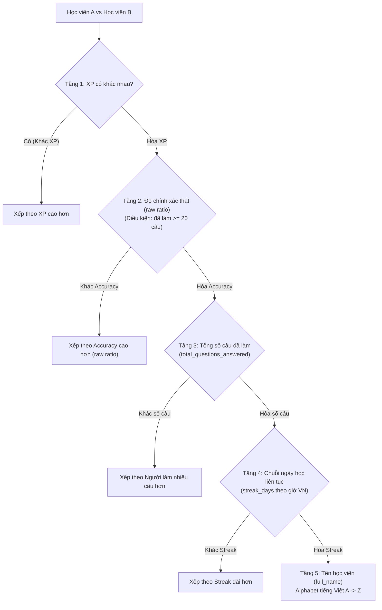

# Quy tắc Tính điểm & Xếp hạng: 4 Tiêu chí Leaderboard (XP, Độ chính xác, Số câu, Streak)

Tài liệu này là **nguồn quy chuẩn kỹ thuật (Single Source of Truth)** về logic tính toán, công thức toán học, nguyên tắc phân định hòa điểm (tie-break cascade), và ma trận các màn hình/tính năng áp dụng 4 tiêu chí xếp hạng cốt lõi của TOEICMaster.

---

## 1. Tổng quan Kiến trúc Xếp hạng Cascade 5 Tầng

Khi tính toán Bảng xếp hạng (`/ranking`), hệ thống áp dụng thuật toán sắp xếp thứ hạng đa tầng nghiêm ngặt (Cascade 5 Levels):



---

## 2. Chi tiết 4 Tiêu chí & Công thức Tính toán

### 2.1. Tiêu chí 1: Kinh nghiệm (XP - Experience Points)
* **Bản chất**: Chỉ số quyết định thứ hạng chính (Tầng 1). Đo lường toàn diện khối lượng kiến thức, nỗ lực làm bài, mức độ gắn bó và các cột mốc thành tích của học viên.
* **Cơ chế tích lũy XP**:
  1. **Luyện tập từng câu hỏi (Practice Questions)**:
     - Trả lời **Đúng**: `+3 XP`
     - Trả lời **Sai**: `+1 XP` (khích lệ tinh thần nỗ lực và học từ lỗi sai)
  2. **Thi Full Test (Đề thi đầy đủ 200 câu)**:
     - Hoàn thành bài thi: `+100 XP`
     - Điểm thưởng mốc thành tích:
       - Đạt $\ge 450$ điểm: `+50 XP`
       - Đạt $\ge 650$ điểm: `+100 XP`
       - Đạt $\ge 750$ điểm: `+150 XP`
       - Đạt $\ge 850$ điểm: `+200 XP`
       - Đạt $\ge 900$ điểm: `+250 XP`
  3. **Hoàn thành Level Practice (`/practice-by-level`)**:
     - Vượt qua một set bài độ khó với độ chính xác $\ge 70\%$: `+30 XP`
  4. **Cột mốc Chuỗi ngày học liên tục (Streak Milestones)**:
     - Duy trì mốc 3 ngày: `+20 XP`
     - Duy trì mốc 7 ngày: `+50 XP`
     - Duy trì mốc 14 ngày: `+100 XP`
     - Duy trì mốc 30 ngày: `+250 XP`
     - Duy trì mốc 60 ngày: `+600 XP`
     - Duy trì mốc 90 ngày: `+1.000 XP`
  5. **Mục tiêu học mỗi ngày (Daily Goal Minutes)**:
     - Học đủ số phút mục tiêu trong ngày (`daily_goal_minutes`): `+15 XP` (ghi nhận 1 lần duy nhất mỗi ngày qua dedupe key `daily_goal:{user_id}:{date}`).
  6. **Quy tắc cấp XP Hồi tố (Retroactive XP Policy)**:
     - Phần tích lũy từ luyện câu hỏi trước ngày có hệ thống XP: áp dụng trần (cap) tối đa `6.599 XP` (ngay dưới mốc Level 11 = `6.600 XP`).
     - Thành tích từ Full Test và Streak Milestone không bị chặn trần.
* **Nguyên tắc an toàn dữ liệu**: Mọi biến động XP bắt buộc phải ghi qua sổ cái `user_xp_ledger` bằng `INSERT IGNORE` với `UNIQUE KEY (dedupe_key)`. Chỉ khi insert ledger thành công mới được tăng `users.xp`.

---

### 2.2. Tiêu chí 2: Độ chính xác (Accuracy Rate)
* **Bản chất**: Tiêu chí phân định hòa thứ nhất (Tầng 2 - Tie-break #1). Khi hai học viên có cùng điểm XP, học viên có chất lượng học tập cao hơn (làm đúng nhiều hơn trên số câu đã làm) sẽ được ưu tiên xếp trên.
* **Ngưỡng kích hoạt (Eligibility Threshold)**:
  - Học viên phải làm **tối thiểu 20 câu hỏi** (`total_questions_answered >= 20`) mới được tham gia tie-break bằng độ chính xác.
  - Học viên làm dưới 20 câu sẽ nhận tỷ lệ so sánh mặc định là `-1.0` (tương đương chưa đủ độ tin cậy thống kê) $\rightarrow$ xếp sau những bạn đã làm đủ $\ge 20$ câu.
* **Quy tắc BẮT BUỘC về Toán học & Tránh lỗi làm tròn (Raw Ratio Rule)**:
  - **TẠI MỆNH ĐỀ SQL `ORDER BY` VÀ HÀM SẮP XẾP PYTHON/TYPESCRIPT**:
    - **Bắt buộc** so sánh bằng **tỷ lệ thô chưa làm tròn (Raw Ratio)**:
      $$\text{Raw Accuracy} = \frac{\text{total\_correct\_answers}}{\text{total\_questions\_answered}}$$
    - Trong SQL: `(u.total_correct_answers * 1.0 / u.total_questions_answered)`
    - Trong Python: `raw_acc = (cq / tq) if tq >= 20 else -1.0`
    - Trong TypeScript: `rawAccuracyRatio = (cq / tq) if tq >= 20 else -1.0`
  - **TUYỆT ĐỐI KHÔNG DÙNG `ROUND(..., 1)` ĐỂ SO SÁNH THỨ HẠNG**:
    - *Bài học production*: Học viên A (1.641/1.762 = 93,133%) và Học viên B (2.170/2.332 = 93,053%) đều hiển thị "93.1%" trên UI. Nếu dùng giá trị làm tròn 93.1% để sort, hệ thống sẽ coi là hòa nhau và đẩy xuống Tầng 3 (Tổng số câu), khiến bạn làm nhiều câu hơn nhưng chính xác kém hơn lại xếp trên!
    - Việc làm tròn 1 chữ số thập phân (`ROUND(rate, 1)`) **CHỈ ĐƯỢC PHÉP DÙNG DUY NHẤT Ở TẦNG HIỂN THỊ UI CHO NGƯỜI DÙNG**.
* **Nguồn dữ liệu**: Được cộng dồn và đồng bộ liên tục vào `users.total_correct_answers` và `users.total_questions_answered` từ 3 bảng dữ liệu:
  1. `user_question_activity` (câu hỏi TOEIC theo Part/Level).
  2. `user_grammar_question_activity` (bài tập ngữ pháp).
  3. `test_attempts` (các câu hỏi trong các bài thi Full Test).

---

### 2.3. Tiêu chí 3: Số câu đã làm (Total Questions Answered)
* **Bản chất**: Tiêu chí phân định hòa thứ hai (Tầng 3 - Tie-break #2). Khi hai học viên hòa cả XP lẫn tỷ lệ độ chính xác thật, học viên nào đã cày cuốc, nỗ lực giải nhiều bài tập hơn sẽ được ưu tiên xếp trên.
* **Công thức**:
  - Dựa trên tổng số câu hỏi mà học viên đã gửi đáp án hợp lệ: `users.total_questions_answered`.
  - Không phân biệt câu đó làm đúng hay sai; mọi tương tác trả lời câu hỏi đều được ghi nhận để tôn vinh tính siêng năng.

---

### 2.4. Tiêu chí 4: Chuỗi ngày học (Streak Days)
* **Bản chất**: Tiêu chí phân định hòa thứ ba (Tầng 4 - Tie-break #3). Khi các tiêu chí trên đều bằng nhau, học viên nào có kỷ luật học tập hàng ngày tốt hơn (chuỗi streak đang dài hơn) sẽ được ưu tiên.
* **Quy tắc tính toán Chuỗi ngày học**:
  - **Múi giờ chuẩn hóa**: **Giờ Việt Nam (UTC+7, `Asia/Ho_Chi_Minh`)**. Tuyệt đối không dùng giờ UTC của server vì sẽ gây lệch mốc chuyển ngày vào 00:00 (lệch 7 tiếng so với thực tế sinh hoạt của học sinh).
  - So sánh ngày học hiện tại `today_vn` với `last_study_date`:
    - Học trong hôm nay (`last_study_date == today_vn`): Giữ nguyên chuỗi ngày hiện tại `streak_days`.
    - Học nối tiếp ngày hôm qua (`last_study_date == today_vn - 1 ngày`): Tăng chuỗi `streak_days += 1`.
    - Cách xa hơn hôm qua (`last_study_date < today_vn - 1 ngày`): Chuỗi bị đứt $\rightarrow$ Reset về `1`.
  - **Hàm bảo vệ `active_streak_days`**: Khi đọc dữ liệu ra màn hình, nếu học viên chưa học hôm nay và lần cuối học đã trước ngày hôm qua (quá 1 ngày trọn vẹn), hàm trả về `0` (streak coi như đã tắt).
  - **Hành động duy trì Streak**:
    1. Trả lời ít nhất 1 câu hỏi luyện tập có gửi đáp án lên server.
    2. Hoặc gửi heartbeat thời gian học tích cực (`POST /api/v1/study-time/ping`) với tab trình duyệt đang mở và hoạt động.

---

## 3. Ma trận Áp dụng của 4 Tiêu chí trên Hệ thống

Bảng tổng hợp chi tiết phạm vi áp dụng và hành vi của từng tiêu chí trên các trang/màn hình:

| Màn hình / Tính năng | Đường dẫn URL | XP | Độ chính xác (Accuracy) | Số câu đã làm | Chuỗi ngày (Streak) |
|---|---|:---:|:---:|:---:|:---:|
| **Bảng xếp hạng (Leaderboard)** | `/ranking` | **Ưu tiên #1**<br/>(Sort key chính, lọc Top 3) | **Tie-break #1**<br/>(Dùng tỷ lệ raw, hiển thị 1 số thập phân) | **Tie-break #2**<br/>(Cột Đã làm & tổng câu cả lớp) | **Tie-break #3**<br/>(Badge ngọn lửa & ngày streak) |
| **Bảng xếp hạng lớp (Cohort)** | `/ranking?tab=cohort` | Sort theo XP lớp | Tỷ lệ chính xác trung bình của lớp | Tổng câu hỏi cả lớp đã làm | Tổng ngày streak của cả lớp |
| **Trang Tổng quan (Dashboard)** | `/dashboard` | Widget Level & XP Bar, modal giải thích cấp bậc | Thẻ Metric Accuracy, Spider Radar Part 1-7 | Thống kê số câu `{correct}/{total}` | Widget Ngọn lửa Streak, lịch điểm danh 7 ngày tuần |
| **Dự đoán điểm AI (AI Prediction)** | `/dashboard` (PredictionCard) | Tính toán pace học tập | Dự đoán điểm Listening & Reading ETS | Mẫu số đánh giá dung lượng dữ liệu | Đánh giá độ đều đặn học tập |
| **Hồ sơ cá nhân (Profile)** | `/profile` | Huy hiệu Level & tổng điểm XP | Thống kê tổng quan học tập | Tổng câu đã hoàn thành | Chuỗi hiện tại & Kỷ lục chuỗi dài nhất (`longestStreak`) |
| **Luyện theo Level** | `/practice-by-level` | Thưởng +30 XP khi đỗ Level | Điều kiện qua ải: Accuracy $\ge 70\%$ | Đếm số câu từng set (10/10, 20/20) | Ghi nhận duy trì streak khi nộp bài |
| **Luyện câu hỏi / Runner** | `/practice/runner` | +3 XP đúng / +1 XP sai | Tính % đúng sau mỗi lượt làm | Đếm số câu hoàn thành trong phiên | Ghi nhận ngày học cho streak |
| **Kết quả thi (Test Result)** | `/test/result` | +100 XP hoàn thành + XP mốc điểm | % Chính xác Listening & Reading | Tổng số 200 câu thi TOEIC | Tự động gia hạn chuỗi streak |
| **Header / Thanh điều hướng** | Toàn bộ các trang | Level badge & XP pill góc trên | — | — | Icon ngọn lửa hiển thị số ngày streak |
| **Active Time Tracker Widget** | Góc phải toàn bộ trang | Thưởng +15 XP khi đạt mục tiêu ngày | — | — | Nhắc nhở giữ lửa chuỗi streak |
| **Admin Quản lý học sinh** | `/admin/students` | Cột xếp loại học sinh theo XP | Đánh giá năng lực học sinh | Đánh giá độ chăm chỉ | Cảnh báo học sinh có nguy cơ đứt chuỗi (`atRisk`) |
| **Admin Chi tiết lớp học** | `/admin/classes/:id` | Bảng xếp hạng nội bộ lớp | Báo cáo tỷ lệ đúng theo từng Part | Tổng bài tập học sinh nộp | Danh sách học sinh mất streak |

---

## 4. Quy chuẩn Code & Triển khai (Developer Guidelines)

1. **Khi sửa câu query SQL Bảng xếp hạng**:
   - Luôn duy trì mệnh đề `ORDER BY`:
     ```sql
     ORDER BY
         u.xp DESC,
         CASE WHEN u.total_questions_answered >= 20
              THEN (u.total_correct_answers * 1.0 / u.total_questions_answered)
              ELSE -1.0 END DESC,
         u.total_questions_answered DESC,
         u.streak_days DESC,
         u.full_name ASC
     ```
2. **Khi sửa logic sắp xếp trên Client (TypeScript)**:
   - Luôn sử dụng hàm `rawAccuracyRatio(member)` thay vì `member.accuracyRate` để sort:
     ```typescript
     export const rawAccuracyRatio = (member: LeaderboardMember): number => (
       (member.totalQuestions || 0) >= MIN_QUESTIONS_FOR_ACCURACY
         ? ((member.correctQuestions || 0) / (member.totalQuestions || 1))
         : -1.0
     );
     ```
3. **Bộ nhớ đệm (Redis Cache)**:
   - Dữ liệu Leaderboard được tính toán và lưu cache tại Redis key `leaderboard:ranking_data` với TTL 120 giây.
   - Khi có can thiệp dữ liệu thủ công hoặc sửa đổi thuật toán, bắt buộc phải xóa key này (`redis-cli del leaderboard:ranking_data`) để bảng xếp hạng tính toán lại ngay lập tức.
