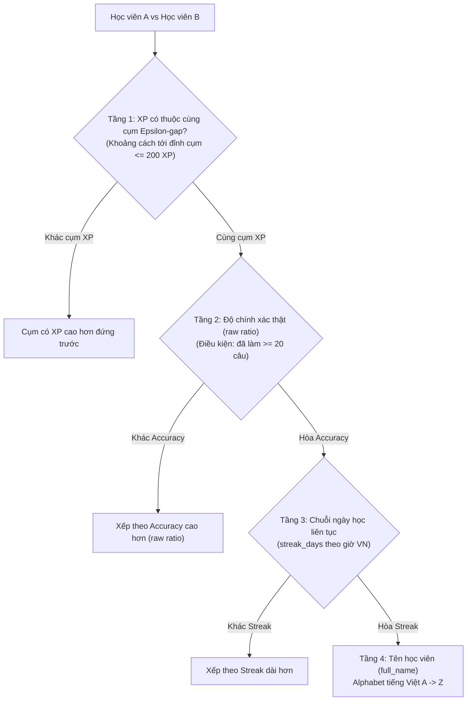

# Quy tắc Tính điểm & Xếp hạng: 4 Tiêu chí Leaderboard (XP, Độ chính xác, Số câu, Streak)

Tài liệu này là **nguồn quy chuẩn kỹ thuật (Single Source of Truth)** về logic tính toán, công thức toán học, nguyên tắc phân định hòa điểm (tie-break cascade), cơ chế gộp cụm XP theo Epsilon-gap, và ma trận các màn hình/tính năng áp dụng 4 tiêu chí xếp hạng cốt lõi của TOEICMaster.

---

## 1. Tổng quan Kiến trúc Xếp hạng Cascade 4 Tầng (Kèm Epsilon-gap Clustering)

Khi tính toán Bảng xếp hạng cá nhân (`/ranking`), hệ thống áp dụng cơ chế **gộp cụm XP theo Epsilon-gap** kết hợp với **Cascade 4 Tầng** nghiêm ngặt:



> **Quyết định rút gọn Cascade**: "Tổng số câu đã làm" được **bỏ khỏi tie-break** xếp hạng cá nhân vì bị đếm trùng trọng số với XP (công thức $XP_{\text{câu hỏi}} = 3 \times \text{đúng} + 1 \times \text{sai} = 2 \times \text{đúng} + \text{Tổng số câu}$). Số câu đã làm vẫn được hiển thị đầy đủ trên UI để ghi nhận nỗ lực cày cuốc, nhưng không tham gia phân định thứ bậc.

---

## 2. Chi tiết Tiêu chí & Cơ chế Thuật toán

### 2.1. Tiêu chí 1: Kinh nghiệm (XP - Experience Points)
* **Bản chất**: Chỉ số nền tảng chia cụm thứ hạng (Tầng 1). Đo lường toàn diện khối lượng bài tập, nỗ lực luyện thi, mức độ gắn bó và các cột mốc thành tích của học viên.
* **Cơ chế tích lũy XP**:
  1. **Luyện tập từng câu hỏi (Practice Questions)**:
     - Trả lời **Đúng**: `+3 XP`
     - Trả lời **Sai**: `+1 XP` (khích lệ tinh thần nỗ lực và học từ lỗi sai)
  2. **Thi Full Test (Đề thi đầy đủ 200 câu)**:
     - Hoàn thành bài thi: `+100 XP`
     - Điểm thưởng mốc thành tích:
       - Đạt $\ge 450$ điểm: `+50 XP`
       - Đạt $\ge 650$ điểm: `+100 XP`
       - Đạt $\ge 750$ điểm: `+150 XP`
       - Đạt $\ge 850$ điểm: `+200 XP`
       - Đạt $\ge 900$ điểm: `+250 XP`
  3. **Hoàn thành Level Practice (`/practice-by-level`)**:
     - Vượt qua một set bài độ khó với độ chính xác $\ge 70\%$: `+30 XP`
  4. **Cột mốc Chuỗi ngày học liên tục (Streak Milestones)**:
     - Duy trì mốc 3 ngày: `+20 XP`
     - Duy trì mốc 7 ngày: `+50 XP`
     - Duy trì mốc 14 ngày: `+100 XP`
     - Duy trì mốc 30 ngày: `+250 XP`
     - Duy trì mốc 60 ngày: `+600 XP`
     - Duy trì mốc 90 ngày: `+1.000 XP`
  5. **Mục tiêu học mỗi ngày (Daily Goal Minutes)**:
     - Học đủ số phút mục tiêu trong ngày (`daily_goal_minutes`): `+15 XP` (ghi nhận 1 lần duy nhất mỗi ngày qua dedupe key `daily_goal:{user_id}:{date}`).
  6. **Quy tắc cấp XP Hồi tố (Retroactive XP Policy)**:
     - Phần tích lũy từ luyện câu hỏi trước ngày có hệ thống XP: áp dụng trần (cap) tối đa `6.599 XP` (ngay dưới mốc Level 11 = `6.600 XP`).
     - Thành tích từ Full Test và Streak Milestone không bị chặn trần.
* **Nguyên tắc an toàn dữ liệu**: Mọi biến động XP bắt buộc phải ghi qua sổ cái `user_xp_ledger` bằng `INSERT IGNORE` với `UNIQUE KEY (dedupe_key)`. Chỉ khi insert ledger thành công mới được tăng `users.xp`.

---

### 2.2. Cơ chế Gộp cụm XP theo Epsilon-gap (Epsilon-gap Clustering)

* **Vấn đề giải quyết**: Trên thực tế, nếu chỉ so sánh bằng XP tuyệt đối, 2 học viên chênh nhau chỉ 1–15 XP (ví dụ 6.614 XP vs 6.599 XP) sẽ bị xếp theo XP mà vô hiệu hóa hoàn toàn chất lượng học tập (Accuracy) và kỷ luật (Streak), dù học viên 6.599 XP có độ chính xác vượt trội (93,1% so với 84%).
* **Ngưỡng Epsilon (`RANKING_XP_CLUSTER_EPSILON = 200`)**:
  - Được cấu hình tập trung tại `server/app/config.py` và có thể tùy biến qua biến môi trường `RANKING_XP_CLUSTER_EPSILON`.
  - Phía Client TypeScript cũng đồng bộ hằng số `RANKING_XP_CLUSTER_EPSILON = 200` tại `client/src/pages/Ranking/components/rankingUi.ts`.
* **Thuật toán so với Đỉnh cụm (Top-of-cluster Comparison)**:
  - Danh sách học viên được sắp xếp giảm dần theo XP: $[u_1, u_2, u_3, \dots]$
  - Khi mở một cụm mới, ghi nhận `cluster_top_xp = u_1.xp`.
  - Các học viên tiếp theo $u_i$ sẽ được nạp vào cùng cụm nếu:
    $$\text{cluster\_top\_xp} - u_i.\text{xp} \le \text{RANKING\_XP\_CLUSTER\_EPSILON}$$
  - Khi gặp học viên có khoảng cách $> \text{epsilon}$, cụm hiện tại được đóng lại, mở cụm mới với học viên đó làm đỉnh cụm mới.
  - **Lý do KHÔNG dùng so sánh liền kề (Chained Comparison)**: Nếu so sánh theo kiểu bậc thang $(u_{i-1}.\text{xp} - u_i.\text{xp} \le \text{epsilon})$, một chuỗi học viên cách đều nhau 150 XP (6.800 $\rightarrow$ 6.650 $\rightarrow$ 6.500 $\rightarrow$ 6.350...) sẽ bị trôi và dồn thành 1 cụm khổng lồ dù đầu và cuối cách nhau hàng nghìn XP. So với đỉnh cụm đảm bảo mọi học viên trong cụm không bao giờ cách người dẫn đầu cụm quá 200 XP.
* **Minh chứng trường hợp thực tế**:
  - Duyên: 6.614 XP, Accuracy 84%
  - Trân_K43: 6.599 XP, Accuracy 93,133%
  - Trân_K39: 6.599 XP, Accuracy 93,053%
  - Cả 3 bạn rơi vào cùng 1 cụm vì $6.614 - 6.599 = 15 \le 200$. Sau khi sắp xếp nội bộ cụm theo Accuracy, thứ hạng chính xác là:
    **#1 Trân_K43 (93,133%) $\rightarrow$ #2 Trân_K39 (93,053%) $\rightarrow$ #3 Duyên (84%)**.

---

### 2.3. Tiêu chí 2: Độ chính xác (Accuracy Rate)
* **Bản chất**: Tiêu chí phân định thứ hai (Tầng 2). Được kích hoạt để sắp xếp các học viên trong cùng một cụm XP. Học viên có chất lượng làm bài cao hơn sẽ xếp trên.
* **Ngưỡng kích hoạt (Eligibility Threshold)**:
  - Học viên phải làm **tối thiểu 20 câu hỏi** (`total_questions_answered >= 20`) mới được tham gia tính tỷ lệ độ chính xác thật.
  - Học viên làm dưới 20 câu sẽ nhận tỷ lệ so sánh mặc định là `-1.0` (tương đương chưa đủ độ tin cậy thống kê) $\rightarrow$ xếp sau những bạn đã làm đủ $\ge 20$ câu trong cùng cụm.
* **Quy tắc BẮT BUỘC về Toán học & Tránh lỗi làm tròn (Raw Ratio Rule)**:
  - **TẠI HÀM SẮP XẾP PYTHON VÀ TYPESCRIPT**:
    - **Bắt buộc** so sánh bằng **tỷ lệ thô chưa làm tròn (Raw Ratio)**:
      $$\text{Raw Accuracy} = \frac{\text{total\_correct\_answers}}{\text{total\_questions\_answered}}$$
    - Trong Python: `raw_acc = (cq / tq) if tq >= 20 else -1.0`
    - Trong TypeScript: `rawAccuracyRatio = (cq / tq) if tq >= 20 else -1.0`
  - **TUYỆT ĐỐI KHÔNG DÙNG `ROUND(..., 1)` ĐỂ SO SÁNH THỨ HẠNG**:
    - *Bài học production*: Học viên Trân_K43 (1.641/1.762 = 93,133%) và Trân_K39 (2.170/2.332 = 93,053%) đều hiển thị "93.1%" trên UI. Nếu dùng giá trị làm tròn 93.1% để sort, hệ thống coi là hòa nhau và đẩy sang tiêu chí tiếp theo.
    - Việc làm tròn 1 chữ số thập phân (`ROUND(rate, 1)`) **CHỈ ĐƯỢC PHÉP DÙNG DUY NHẤT Ở TẦNG HIỂN THỊ UI CHO NGƯỜI DÙNG**.

---

### 2.4. Tiêu chí 3: Số câu đã làm (Total Questions Answered)
* **Bản chất**: **Chỉ số thông tin và tôn vinh nỗ lực trên giao diện**, không còn vai trò tie-break trong xếp hạng cá nhân.
* **Lý do loại khỏi cascade xếp hạng**:
  - Trọng số của số câu đã làm đã được tính thẳng vào XP theo công thức luyện câu hỏi ($XP = 2 \times \text{đúng} + \text{Tổng số câu}$). Việc dùng lại số câu làm tiêu chí phân định thứ bậc cá nhân dẫn đến tính trùng 2 lần yếu tố khối lượng, lấn át tiêu chí độ chính xác và chuỗi chuyên cần.
  - Vẫn giữ hiển thị thẻ "Đã làm: X câu" trên UI của từng học sinh để ghi nhận tinh thần siêng năng.

---

### 2.5. Tiêu chí 4: Chuỗi ngày học (Streak Days)
* **Bản chất**: Tiêu chí phân định thứ ba (Tầng 3). Khi hai học viên trong cùng một cụm XP có cùng tỷ lệ độ chính xác thật (raw accuracy), học viên nào có kỷ luật học tập đều đặn hàng ngày tốt hơn (chuỗi streak đang dài hơn) sẽ được xếp trên.
* **Quy tắc tính toán Chuỗi ngày học**:
  - **Múi giờ chuẩn hóa**: **Giờ Việt Nam (UTC+7, `Asia/Ho_Chi_Minh`)**. Tuyệt đối không dùng giờ UTC của server vì sẽ gây lệch mốc chuyển ngày vào 00:00.
  - So sánh ngày học hiện tại `today_vn` với `last_study_date`:
    - Học trong hôm nay (`last_study_date == today_vn`): Giữ nguyên chuỗi ngày hiện tại `streak_days`.
    - Học nối tiếp ngày hôm qua (`last_study_date == today_vn - 1 ngày`): Tăng chuỗi `streak_days += 1`.
    - Cách xa hơn hôm qua (`last_study_date < today_vn - 1 ngày`): Chuỗi bị đứt $\rightarrow$ Reset về `1`.
  - **Hàm bảo vệ `active_streak_days`**: Khi đọc dữ liệu ra màn hình, nếu học viên chưa học hôm nay và lần cuối học đã trước ngày hôm qua (quá 1 ngày trọn vẹn), hàm trả về `0` (streak coi như đã tắt).

---

## 3. Ma trận Áp dụng của 4 Tiêu chí trên Hệ thống

Bảng tổng hợp chi tiết phạm vi áp dụng và hành vi của từng tiêu chí trên các trang/màn hình:

| Màn hình / Tính năng | Đường dẫn URL | XP | Độ chính xác (Accuracy) | Số câu đã làm | Chuỗi ngày (Streak) |
|---|---|:---:|:---:|:---:|:---:|
| **Bảng xếp hạng cá nhân** | `/ranking` | **Cụm XP #1**<br/>(Gộp cụm Epsilon = 200) | **Tie-break #1**<br/>(Dùng tỷ lệ raw trong cụm) | **Thông tin hiển thị**<br/>(Không dùng để xếp hạng cá nhân) | **Tie-break #2**<br/>(Xếp sau Accuracy trong cụm) |
| **Bảng xếp hạng lớp (Cohort)** | `/ranking?tab=cohort` | Gộp cụm XP trong lớp | Tie-break #1 trong lớp | Thông tin hiển thị của học viên | Tie-break #2 trong lớp |
| **Xếp hạng liên lớp (Inter-class)** | `/ranking` (Widget Sidebar) | — | Tỷ lệ chính xác trung bình của lớp | **Xếp hạng liên lớp #1**<br/>(Tổng câu toàn bộ lớp đã cày) | Tie-break liên lớp #2 |
| **Trang Tổng quan (Dashboard)** | `/dashboard` | Widget Level & XP Bar, modal cấp bậc | Thẻ Metric Accuracy, Spider Radar Part 1-7 | Thống kê số câu `{correct}/{total}` | Widget Ngọn lửa Streak, lịch điểm danh 7 ngày |
| **Dự đoán điểm AI (AI Prediction)** | `/dashboard` (PredictionCard) | Đánh giá pace học tập | Dự đoán điểm Listening & Reading ETS | Mẫu số đánh giá dung lượng dữ liệu | Đánh giá tính đều đặn học tập |
| **Hồ sơ cá nhân (Profile)** | `/profile` | Huy hiệu Level & tổng điểm XP | Thống kê tổng quan học tập | Tổng câu đã hoàn thành | Chuỗi hiện tại & Kỷ lục chuỗi (`longestStreak`) |
| **Luyện theo Level** | `/practice-by-level` | Thưởng +30 XP khi đỗ Level | Điều kiện qua ải: Accuracy $\ge 70\%$ | Đếm số câu từng set (10/10, 20/20) | Duy trì streak khi nộp bài |
| **Luyện câu hỏi / Runner** | `/practice/runner` | +3 XP đúng / +1 XP sai | Tính % đúng sau mỗi lượt làm | Đếm số câu hoàn thành trong phiên | Ghi nhận ngày học cho streak |
| **Kết quả thi (Test Result)** | `/test/result` | +100 XP hoàn thành + XP mốc điểm | % Chính xác Listening & Reading | Tổng số 200 câu thi TOEIC | Tự động gia hạn chuỗi streak |
| **Header / Thanh điều hướng** | Toàn bộ các trang | Level badge & XP pill góc trên | — | — | Icon ngọn lửa hiển thị số ngày streak |
| **Active Time Tracker Widget** | Toàn bộ các trang | Thưởng +15 XP khi đạt mục tiêu ngày | — | — | Nhắc nhở giữ lửa chuỗi streak |
| **Admin Quản lý học sinh** | `/admin/students` | Cột xếp loại học sinh theo XP | Đánh giá năng lực học sinh | Đánh giá độ chăm chỉ | Cảnh báo học sinh nguy cơ đứt chuỗi (`atRisk`) |
| **Admin Chi tiết lớp học** | `/admin/classes/:id` | Bảng xếp hạng nội bộ lớp | Báo cáo tỷ lệ đúng theo từng Part | Tổng bài tập học sinh nộp | Danh sách học sinh mất streak |

---

## 4. Quy chuẩn Code & Triển khai (Developer Guidelines)

### 4.1. Backend Python (`server/app/routers/ranking.py`)
```python
RANKING_XP_CLUSTER_EPSILON = getattr(config, "RANKING_XP_CLUSTER_EPSILON", 200)
MIN_QUESTIONS_FOR_ACCURACY = 20

def cluster_by_xp(users_sorted_by_xp_desc: list, epsilon: int = RANKING_XP_CLUSTER_EPSILON) -> list:
    clusters = []
    current_cluster = []
    cluster_top_xp = None
    for user in users_sorted_by_xp_desc:
        user_xp = int(user.get("xp") or 0)
        if cluster_top_xp is None or (cluster_top_xp - user_xp) <= epsilon:
            if cluster_top_xp is None:
                cluster_top_xp = user_xp
            current_cluster.append(user)
        else:
            clusters.append(current_cluster)
            current_cluster = [user]
            cluster_top_xp = user_xp
    if current_cluster:
        clusters.append(current_cluster)
    return clusters

def _cluster_member_sort_key(member: dict):
    tq = member["totalQuestions"]
    cq = member["correctQuestions"]
    raw_acc = (cq / tq) if tq >= MIN_QUESTIONS_FOR_ACCURACY else -1.0
    full_name = f"{member.get('familyMiddleName', '')} {member['name']}".strip()
    return (
        -raw_acc,
        -member["streakDays"],
        full_name,
    )

def sort_and_rank_by_xp_clusters(members: list, epsilon: int = RANKING_XP_CLUSTER_EPSILON) -> list:
    if not members:
        return []
    by_xp_desc = sorted(members, key=lambda m: (-int(m.get("xp") or 0), str(m.get("id") or "")))
    clusters = cluster_by_xp(by_xp_desc, epsilon=epsilon)
    ranked = []
    for cluster in clusters:
        cluster.sort(key=_cluster_member_sort_key)
        ranked.extend(cluster)
    return ranked
```

### 4.2. Client TypeScript (`client/src/pages/Ranking/components/rankingUi.ts`)
```typescript
export const RANKING_XP_CLUSTER_EPSILON = 200;

export const clusterByXp = <T extends { xp?: number }>(
  usersSortedByXpDesc: T[],
  epsilon = RANKING_XP_CLUSTER_EPSILON,
): T[][] => {
  const clusters: T[][] = [];
  let currentCluster: T[] = [];
  let clusterTopXp: number | null = null;

  for (const user of usersSortedByXpDesc) {
    const userXp = user.xp || 0;
    if (clusterTopXp === null || (clusterTopXp - userXp) <= epsilon) {
      if (clusterTopXp === null) {
        clusterTopXp = userXp;
      }
      currentCluster.push(user);
    } else {
      clusters.push(currentCluster);
      currentCluster = [user];
      clusterTopXp = userXp;
    }
  }
  if (currentCluster.length > 0) {
    clusters.push(currentCluster);
  }
  return clusters;
};

export const sortClusterMembers = (members: LeaderboardMember[]): LeaderboardMember[] => (
  [...members].sort((left, right) => (
    rawAccuracyRatio(right) - rawAccuracyRatio(left)
    || (right.streakDays || 0) - (left.streakDays || 0)
    || studentFullName(left).localeCompare(studentFullName(right), 'vi')
  ))
);

export const sortRankingMembers = (
  members: LeaderboardMember[],
  epsilon = RANKING_XP_CLUSTER_EPSILON,
): LeaderboardMember[] => {
  if (!members.length) return [];
  const byXpDesc = [...members].sort((a, b) => ((b.xp || 0) - (a.xp || 0)) || a.id.localeCompare(b.id));
  const clusters = clusterByXp(byXpDesc, epsilon);
  return clusters.flatMap(sortClusterMembers);
};
```

### 4.3. Quản lý Cache Redis
- Dữ liệu Leaderboard được lưu cache tại Redis key `leaderboard:ranking_data` với TTL 120 giây.
- Sau khi deploy thay đổi logic xếp hạng hoặc gộp cụm, xóa cache ngay:
  ```bash
  redis-cli del leaderboard:ranking_data
  ```
