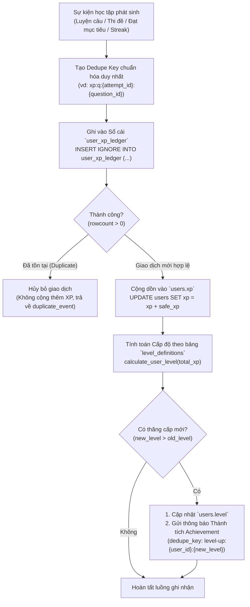
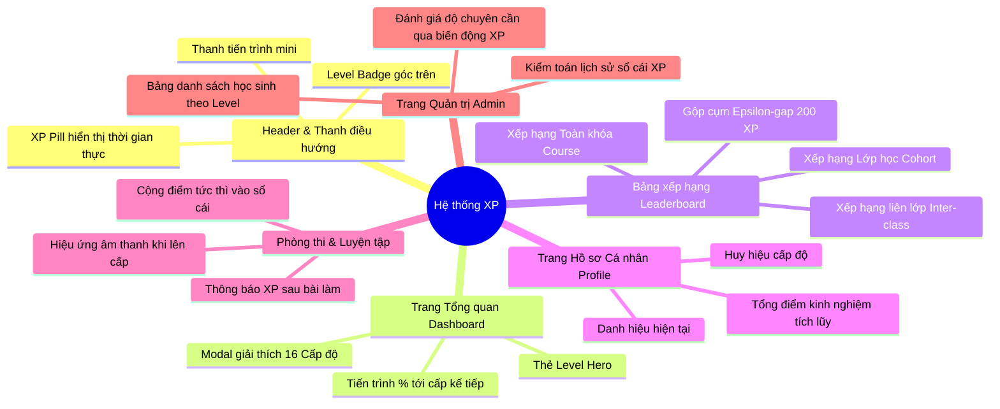

# Quy chuẩn Kỹ thuật: Toàn bộ Luồng Cộng Điểm XP & Hệ thống Gamification

Tài liệu này là **nguồn quy chuẩn kỹ thuật (Single Source of Truth)** mô tả chi tiết toàn bộ các luồng cộng điểm kinh nghiệm (XP - Experience Points), cơ chế sổ cái bất biến (Idempotent Ledger), bảng 16 cấp bậc (Level), và ma trận tác động của XP trên toàn bộ các tính năng của website TOEICMaster (ilovetoeic.com).

---

## 1. Tổng quan Kiến trúc Hệ thống XP & Sổ cái Bất biến (`user_xp_ledger`)

Hệ thống Gamification của TOEICMaster được xây dựng theo nguyên tắc **bất biến và chống trùng lặp tuyệt đối (Idempotent Event Sourcing)**:



### Nguyên tắc thiết kế cốt lõi:
1. **Sổ cái trước - Dữ liệu sau (Ledger First)**:
   - Mọi thay đổi điểm XP **bắt buộc** phải ghi qua bảng `user_xp_ledger` trước khi được phép tăng `users.xp`.
   - `user_xp_ledger.dedupe_key` có ràng buộc `UNIQUE`. Nếu một sự kiện đã từng được xử lý (do người dùng click đúp, mạng chập chờn retry, hoặc spam API), câu lệnh `INSERT IGNORE` sẽ trả về `0 rows affected` và hệ thống lập tức bỏ qua.
2. **Ngăn chặn gian lận (Anti-tampering & Safeguards)**:
   - Giá trị XP mỗi lần cộng luôn được ép kiểu và chặn trong ngưỡng an toàn: `safe_xp = max(1, min(int(xp_amount), 50000))`.
   - Không cho phép tài khoản khách (`guest`) nhận XP.
   - Thao tác cộng điểm diễn ra bất đồng bộ qua `BackgroundTasks` hoặc Transaction nhằm đảm bảo độ phản hồi tức thì cho người dùng (< 50ms).

---

## 2. Bảng Tổng hợp Toàn bộ Luồng Cộng Điểm XP

| STT | Tên luồng / Sự kiện | Màn hình / Tính năng phát sinh | Điểm XP được cộng | Mã Dedupe Key (`dedupe_key`) | Mã hoạt động (`activity_type`) |
|:---:|---|---|:---:|---|---|
| **1** | **Luyện tập câu hỏi: Đúng** | - Luyện Part 1–7 (`/practice/runner`)<br/>- Luyện theo Level (`/practice-by-level`)<br/>- Luyện Ngữ pháp (`/grammar`)<br/>- Luyện đề rút gọn (`/mock-test`) | **+5 XP** / câu | `xp:q:{attempt_id}:{question_id}` | `practice_question` |
| **2** | **Luyện tập câu hỏi: Chưa đúng** | Các màn hình luyện tập câu hỏi như trên | **+1 XP** / câu | `xp:q:{attempt_id}:{question_id}` | `practice_question` |
| **3** | **Hoàn thành Full Test TOEIC** | - Phòng thi Full Test (`/mock-test/exam` - Đề 200 câu, `mode = 'exam'`) | **+100 XP** + `(total_score // 10)` XP | `xp:test:{attempt_id}` | `test_completion` |
| **4** | **Hoàn thành Mini Test / Phần thi** | - Phòng thi rút gọn (`/mock-test/exam`, `mode = 'exam'`) | **+30 XP** | `xp:test:{attempt_id}` | `test_completion` |
| **5** | **Vượt qua cấp độ Luyện theo Level** | - Luyện Level (`/practice-by-level`, `mode = 'practice'`)<br/>- Điều kiện: Đạt độ chính xác $\ge 70\%$ và **không phải** làm lại câu sai | **+30 XP** | `xp:level:{attempt_id}` | `level_completion` |
| **6** | **Làm lại câu sai (Retry)** | - Luyện lại câu sai (`/practice/runner?wrongSource=...`) | **+0 XP hoàn thành**<br/>*(Chỉ nhận XP từng câu: +5 đúng, +1 sai)* | *(Không áp dụng thưởng lượt làm)* | `practice_question` |
| **7** | **Đạt Mục tiêu Học tập Hàng ngày** | - Toàn bộ trang (Active Time Tracker / Heartbeat) | **+25 XP** / ngày | `xp:daily_goal:{user_id}:{study_date}` | `daily_goal` |
| **8** | **Cột mốc Chuỗi Streak 3 ngày** | - Toàn bộ trang khi học nối tiếp streak | **+50 XP** | `xp:streak:{user_id}:3` | `streak_milestone` |
| **9** | **Cột mốc Chuỗi Streak 7 ngày (1 tuần)** | - Toàn bộ trang khi học nối tiếp streak | **+100 XP** | `xp:streak:{user_id}:7` | `streak_milestone` |
| **10** | **Cột mốc Chuỗi Streak 14 ngày (2 tuần)** | - Toàn bộ trang khi học nối tiếp streak | **+200 XP** | `xp:streak:{user_id}:14` | `streak_milestone` |
| **11** | **Cột mốc Chuỗi Streak 30 ngày (1 tháng)** | - Toàn bộ trang khi học nối tiếp streak | **+500 XP** | `xp:streak:{user_id}:30` | `streak_milestone` |
| **12** | **Cột mốc Chuỗi Streak 60 ngày (2 tháng)** | - Toàn bộ trang khi học nối tiếp streak | **+1.000 XP** | `xp:streak:{user_id}:60` | `streak_milestone` |
| **13** | **Cột mốc Chuỗi Streak 100 ngày** | - Toàn bộ trang khi học nối tiếp streak | **+2.000 XP** | `xp:streak:{user_id}:100` | `streak_milestone` |
| **14** | **Cột mốc Chuỗi Streak 200 ngày** | - Toàn bộ trang khi học nối tiếp streak | **+3.000 XP** | `xp:streak:{user_id}:200` | `streak_milestone` |
| **15** | **Cột mốc Chuỗi Streak 365 ngày (1 năm)** | - Toàn bộ trang khi học nối tiếp streak | **+5.000 XP** | `xp:streak:{user_id}:365` | `streak_milestone` |
| **16** | **Cấp bù Hồi tố: Câu hỏi lịch sử** | - Script hệ thống (`backfill_retroactive_xp.py`) | Đúng: +3 XP / Sai: +1 XP (Trần: 6.599 XP) | `xp:retro_practice_v1:{user_id}` | `retroactive_practice` |
| **17** | **Cấp bù Hồi tố: Full Test lịch sử** | - Script hệ thống (`backfill_retroactive_xp.py`) | +100 XP + `(total_score // 10)` XP | `xp:test:{ta.id}` | `test_completion` |
| **18** | **Cấp bù Hồi tố: Streak lịch sử** | - Script hệ thống (`backfill_retroactive_xp.py`) | Tương ứng các mốc đạt được dựa trên `longest_streak` | `xp:streak:{user_id}:{milestone}` | `streak_milestone` |

---

## 3. Chi tiết Từng Luồng Cộng Điểm Trên Hệ Thống

### 3.1. Luồng 1: Luyện tập Câu hỏi (Practice Question XP)
* **Trang áp dụng**:
  - **Luyện theo Part**: `/practice/runner` (Part 1, Part 2, Part 3, Part 4, Part 5, Part 6, Part 7).
  - **Luyện theo Level**: `/practice-by-level` (Level 1 đến Level 5 theo từng kỹ năng).
  - **Luyện Ngữ pháp TOEIC**: `/grammar` (Các chủ điểm ngữ pháp, chuyên đề, câu sai).
  - **Luyện đề thi dạng Practice**: `/mock-test` khi chọn chế độ luyện tập.
* **Cơ chế gửi dữ liệu từ Frontend**:
  - Khi học viên chọn đáp án, hook `useQuestionActivityBatch` gom các câu trả lời vào hàng đợi cục bộ.
  - Hàng đợi tự động gửi một batch lên server qua API:
    ```http
    PUT /api/v1/study-activity/questions
    ```
* **Quy tắc cộng điểm**:
  - Câu trả lời **Đúng**: `+5 XP`
  - Câu trả lời **Chưa đúng / Sai**: `+1 XP` (khích lệ học tập từ lỗi sai, tránh tâm lý sợ làm bài).
* **Bảo vệ chống cộng lặp**:
  - Mỗi câu hỏi trong một phiên luyện tập (`attempt_id`) chỉ được cộng điểm **1 lần duy nhất** qua dedupe key:
    $$\text{dedupe\_key} = \text{xp:q:}\{\text{attempt\_id}\}:\{\text{question\_id}\}$$
  - Nếu người dùng chuyển qua lại và chọn lại đáp án cho câu đó trong cùng phiên, hệ thống chỉ cập nhật đáp án đã chọn (`selected_answer`) và delta số câu đúng trong bảng hoạt động, **không cộng thêm XP lần thứ hai**.

---

### 3.2. Luồng 2: Hoàn thành Đề thi trong Phòng thi (Test Completion XP)
* **Trang áp dụng**:
  - **Phòng thi thử Full Test**: `/mock-test/exam` (Đề chuẩn 200 câu Listening & Reading thời lượng 120 phút, `mode = 'exam'`).
  - **Thi theo từng Part / Mini Test**: `/mock-test/exam` khi chọn làm riêng lẻ từng phần dưới dạng thi thử có tính giờ (`mode = 'exam'`).
* **API Endpoints**:
  - `POST /api/v1/submissions` (Endpoint nộp bài thi chính).
  - `POST /api/v1/study-attempts` (Endpoint lưu lượt thi đồng bộ tiến độ).
* **Công thức tính toán**:
  1. **Đối với bài thi Full Test hoàn chỉnh (`is_partial == False`)**:
     $$\text{XP Nhận được} = 100 + \left\lfloor \frac{\text{total\_score}}{10} \right\rfloor$$
     *Ví dụ cụ thể:*
     - Thi được **450 điểm**: $100 + 45 = \mathbf{145\text{ XP}}$
     - Thi được **650 điểm**: $100 + 65 = \mathbf{165\text{ XP}}$
     - Thi được **750 điểm**: $100 + 75 = \mathbf{175\text{ XP}}$
     - Thi được **850 điểm**: $100 + 85 = \mathbf{185\text{ XP}}$
     - Thi được **900 điểm**: $100 + 90 = \mathbf{190\text{ XP}}$
     - Thi được **990 điểm tối đa**: $100 + 99 = \mathbf{199\text{ XP}}$
  2. **Đối với bài thi từng phần rút gọn trong phòng thi (`is_partial == True`, `mode = 'exam'`)**:
     $$\text{XP Nhận được} = \mathbf{30\text{ XP}}$$
* **Bảo vệ chống cộng lặp**:
  - Khóa theo mã lượt thi: `xp:test:{attempt_id}`. Đảm bảo dù nộp bài ở nhiều tab hay gọi lại API thì mỗi lượt thi chỉ nhận thưởng đúng một lần.

---

### 3.3. Luồng 3: Vượt qua Cấp độ Luyện theo Level & Quy tắc Làm lại Câu sai (Level Completion & Wrong Retry Rules)
* **Trang áp dụng**:
  - **Luyện theo Level**: `/practice-by-level` (Chạy qua `/practice/runner/:part?level=:level`, `mode = 'practice'`).
* **Nguyên tắc phân định rõ ràng giữa Luyện bài mới và Làm lại câu sai**:
  1. **Làm lại câu sai (Wrong questions retry)**:
     - Ví dụ: Người dùng chọn *"Làm lại 4 câu sai Part 3"* (`wrongSource=level` hoặc `wrongSource=test`).
     - **Chỉ nhận XP theo từng câu**: Học viên trả lời câu nào đúng nhận +5 XP, câu nào sai nhận +1 XP qua Luồng 1.
     - **Tuyệt đối KHÔNG cộng 30 XP hoàn thành**: Làm lại câu sai chỉ là rà soát lỗ hổng kiến thức, không phải là một lượt thi hay bài kiểm tra chuẩn hóa.
     - **Tuyệt đối KHÔNG cập nhật `user_level_stats`**: Tránh tình trạng chỉ làm 1–4 câu sai mà được hệ thống ghi nhận là đã hoàn thành/thăng cấp độ của Part đó.
  2. **Luyện tập bộ câu hỏi Level chính thức (`source = 'level_practice'`)**:
     - Khi học viên làm bài tập Level thật sự (không phải làm lại câu sai):
       - Nếu **Độ chính xác $\ge 70\%$** (Đạt chuẩn qua ải):
         - Thưởng **+30 XP** với `dedupe_key = xp:level:{attempt_id}` (Mã hoạt động `level_completion`).
         - Cập nhật cấp độ cao nhất đã đạt trong `user_level_stats`.
       - Nếu **Độ chính xác $< 70\%$** (Chưa đạt chuẩn):
         - **Không cộng thưởng 30 XP**.
         - Không cập nhật `user_level_stats`.
         - Học viên vẫn giữ nguyên điểm XP từ các câu hỏi đã làm (+5 đúng, +1 sai).

---

### 3.4. Luồng 4: Đạt Mục tiêu Học tập Hàng ngày (Daily Goal XP)
* **Trang áp dụng**:
  - Hoạt động ngầm trên toàn bộ website thông qua `Active Time Tracker Widget` và lệnh gửi nhịp tim định kỳ:
    ```http
    POST /api/v1/study-time/ping
    ```
  - Hoặc kích hoạt ngay khi hoàn thành câu hỏi luyện tập đầu tiên trong ngày.
* **Điều kiện kích hoạt**:
  - Tổng thời gian học trong ngày tích lũy tại bảng `user_daily_study_time.total_seconds` đạt hoặc vượt mốc mục tiêu `daily_goal_minutes * 60` (mặc định là **30 phút/ngày**).
* **Mức thưởng**: **+25 XP**
* **Bảo vệ chống cộng lặp**:
  - Dedupe key gắn liền với ngày học theo giờ Việt Nam:
    $$\text{dedupe\_key} = \text{xp:daily\_goal:}\{\text{user\_id}\}:\{\text{YYYY-MM-DD}\}$$
  - Đảm bảo mỗi học viên chỉ có thể nhận tối đa **1 lần thưởng mục tiêu ngày** trong một ngày dương lịch.

---

### 3.5. Luồng 5: Cột mốc Chuỗi Ngày Học (Streak Milestone XP)
* **Trang áp dụng**:
  - Tự động kích hoạt khi học viên thực hiện bất kỳ hoạt động học tập hợp lệ nào (trả lời câu hỏi hoặc gửi heartbeat) nối tiếp chuỗi ngày học của ngày hôm trước sang ngày hôm nay (tính theo múi giờ `Asia/Ho_Chi_Minh`, UTC+7).
* **Bảng các mốc thưởng Streak**:

| Mốc ngày Streak | Mức thưởng XP | Ý nghĩa danh hiệu | Dedupe Key |
|:---:|:---:|---|---|
| **3 ngày** | **+50 XP** | Thói quen bước đầu | `xp:streak:{user_id}:3` |
| **7 ngày** (1 tuần) | **+100 XP** | Kỷ luật một tuần trọn vẹn | `xp:streak:{user_id}:7` |
| **14 ngày** (2 tuần) | **+200 XP** | Bứt phá thói quen | `xp:streak:{user_id}:14` |
| **30 ngày** (1 tháng) | **+500 XP** | Chiến binh kiên trì | `xp:streak:{user_id}:30` |
| **60 ngày** (2 tháng) | **+1.000 XP** | Bậc thầy chuyên cần | `xp:streak:{user_id}:60` |
| **100 ngày** | **+2.000 XP** | Cột mốc 100 ngày vàng | `xp:streak:{user_id}:100` |
| **200 ngày** | **+3.000 XP** | Đẳng cấp bền bỉ | `xp:streak:{user_id}:200` |
| **365 ngày** (1 năm) | **+5.000 XP** | Huyền thoại xuyên năm | `xp:streak:{user_id}:365` |

* **Thông báo kèm theo**: Khi đạt mốc, hệ thống đồng thời tạo một thông báo thành tích loại `achievement` gửi thẳng vào chuông thông báo cá nhân của học viên.

---

### 3.5. Luồng 5: Chính sách Cấp XP Hồi tố (Retroactive XP Policy)
* **Bối cảnh**: Khi hệ thống XP chính thức ra mắt, học viên cũ đã có lịch sử hàng nghìn câu hỏi trước đó. Để đảm bảo công bằng, một lượt cấp bù duy nhất đã được thiết kế.
* **Nguyên tắc phân bổ công bằng**:
  1. **Câu hỏi luyện tập trong quá khứ**: Cấp theo công thức `+3 XP/đúng` và `+1 XP/sai`, nhưng **áp dụng trần tối đa 6.599 XP** (ngay dưới mốc Level 11 = 6.600 XP).
     *Lý do:* Danh hiệu từ Level 11 trở lên gắn với các mốc điểm thi TOEIC thật (650+, 750+, 850+, 900+, 950+, 990) – chỉ mở khóa qua Full Test hoặc quá trình tích lũy sau khi hệ thống hoạt động.
  2. **Bài thi Full Test trong quá khứ**: **Không bị giới hạn trần**, tính đúng theo công thức $100 + (\text{score} // 10)$.
  3. **Mốc Streak cao nhất từng đạt (`longest_streak`)**: **Không bị giới hạn trần**, cấp bù toàn bộ các mốc mà học viên từng vượt qua trong lịch sử.

---

## 4. Hệ thống 16 Cấp bậc & Danh hiệu (Levels & Titles)

Khi tích lũy đủ XP, học viên sẽ tự động thăng cấp và đổi danh hiệu tương ứng. Dữ liệu được quản lý tập trung tại bảng `level_definitions`:

| Cấp độ | Ngưỡng XP yêu cầu | Danh hiệu (Tiếng Việt) | Biểu tượng Badge | Tông màu hiển thị | Ý nghĩa cột mốc |
|:---:|:---:|---|:---:|:---:|---|
| **Level 1** | **0 XP** | Tập sự TOEIC | `sprout` | Emerald | Điểm khởi đầu của mọi học viên |
| **Level 2** | **100 XP** | Khởi động TOEIC | `footprints` | Teal | Đã hoàn thành những bài đầu tiên |
| **Level 3** | **300 XP** | Bứt phá sơ cấp | `compass` | Sky | Xây dựng nhịp học đều đặn |
| **Level 4** | **600 XP** | Tăng tốc từ vựng | `book-open` | Blue | Tích lũy vốn từ vựng nền tảng |
| **Level 5** | **1.000 XP** | Chiến binh ngữ pháp | `shield` | Indigo | Làm chủ các cấu trúc câu trọng yếu |
| **Level 6** | **1.500 XP** | Chuyên cần Part 5-6 | `zap` | Amber | Đạt tốc độ xử lý nhanh ở bài đọc ngắn |
| **Level 7** | **2.200 XP** | Tai nghe thính nhạy | `headphones` | Orange | Cải thiện rõ rệt kỹ năng Listening Part 1-4 |
| **Level 8** | **3.000 XP** | Kỳ thủ đọc hiểu | `glasses` | Rose | Nâng cao tốc độ làm Part 7 đoạn đơn & kép |
| **Level 9** | **4.000 XP** | Thợ săn bẫy đề | `crosshair` | Red | Khả năng né các bẫy đề thi kinh điển |
| **Level 10** | **5.200 XP** | Chiến tướng TOEIC | `swords` | Purple | Đỉnh cao của khối lượng luyện tập độc lập |
| **Level 11** | **6.600 XP** | Chinh phục 650+ | `medal` | Violet | Tương đương năng lực TOEIC 650+ |
| **Level 12** | **8.200 XP** | Cao thủ 750+ | `award` | Pink | Tương đương năng lực TOEIC 750+ |
| **Level 13** | **10.000 XP** | Đại kiện tướng 850+ | `trophy` | Yellow | Tương đương năng lực TOEIC 850+ |
| **Level 14** | **12.500 XP** | Huyền thoại 900+ | `crown` | Amber | Xuất sắc, phản xạ tự nhiên |
| **Level 15** | **15.500 XP** | Bậc thầy TOEIC 950+ | `gem` | Cyan | Trình độ xuất sắc gần như tuyệt đối |
| **Level 16** | **19.000 XP** | Vua TOEIC 990 | `sparkles` | Emerald | Đỉnh cao danh vọng tối thượng |

---

## 5. Ma trận Tác động của XP trên Toàn bộ Website

Hệ thống điểm XP và Level ảnh hưởng trực tiếp đến giao diện và hành vi trên các trang:



### Chi tiết hiển thị theo trang:
1. **Header / Navigation Bar (Toàn bộ các trang)**:
   - Hiển thị huy hiệu Level, biểu tượng icon tương ứng và thanh tiến trình XP thu nhỏ bên cạnh thông tin người dùng.
2. **Trang Tổng quan (Dashboard - `/dashboard`)**:
   - **Hero Level Card**: Trình bày danh hiệu, cấp bậc, thanh tiến trình tỷ lệ phần trăm (`progressPercent`) và số XP cần tích lũy thêm để lên cấp (`xpRemaining`).
   - Click vào thẻ mở modal tra cứu toàn bộ 16 mốc danh hiệu và quyền lợi mở khóa.
3. **Bảng xếp hạng (Leaderboard - `/ranking`)**:
   - **Xếp hạng cá nhân**: Áp dụng cơ chế **Epsilon-gap Clustering** (`RANKING_XP_CLUSTER_EPSILON = 200`). Các học viên có điểm XP chênh lệch trong khoảng 200 XP được đưa vào cùng một cụm và phân định thứ bậc công bằng dựa trên **Độ chính xác thật (raw accuracy)** và **Chuỗi ngày học (streak)**.
   - **Xếp hạng liên lớp (Inter-Class)**: Cộng tổng điểm XP của tất cả học viên trong lớp để vinh danh lớp học có tổng nỗ lực cao nhất.
4. **Hồ sơ cá nhân (Profile - `/profile`)**:
   - Hiển thị danh hiệu cá nhân, huy hiệu cấp độ và tổng số XP đạt được.
5. **Hệ thống Thông báo (In-App Notifications - `/notifications`)**:
   - Tự động kích hoạt thông báo chúc mừng thăng cấp và đạt mốc chuỗi ngày học.

---

## 6. API Endpoints & Hướng dẫn Kiểm toán Sổ cái (Ledger Audit)

### 6.1. Danh sách Endpoints liên quan đến Gamification
- `GET /api/v1/gamification/level-info`: Lấy thông tin cấp độ hiện tại, tiến trình %, danh hiệu, và icon của học viên đang đăng nhập.
- `GET /api/v1/gamification/level-definitions`: Lấy danh sách 16 cấp bậc chuẩn của hệ thống (phục vụ hiển thị modal tham khảo).
- `GET /api/v1/gamification/xp-history?limit=20`: Truy vấn lịch sử các giao dịch cộng XP gần nhất từ sổ cái `user_xp_ledger`.
- `GET /api/v1/leaderboard?scope=course|cohort|cohorts`: Lấy bảng xếp hạng đã được gộp cụm theo XP và sắp xếp tối ưu qua Redis cache.

### 6.2. Kiểm tra tính toàn vẹn dữ liệu (Integrity Check Query)
Để kiểm toán hoặc kiểm tra xem điểm XP hiển thị trên bảng `users` có khớp chính xác với lịch sử sổ cái hay không, chạy câu query:

```sql
SELECT 
    u.id,
    u.full_name,
    u.xp AS user_table_xp,
    COALESCE(SUM(l.xp_amount), 0) AS ledger_total_xp,
    (u.xp - COALESCE(SUM(l.xp_amount), 0)) AS diff
FROM users u
LEFT JOIN user_xp_ledger l ON l.user_id = u.id
WHERE u.role = 'student'
GROUP BY u.id, u.full_name, u.xp
HAVING diff != 0;
```
*(Nếu hệ thống vận hành chuẩn xác, câu query trên phải trả về 0 dòng).*
